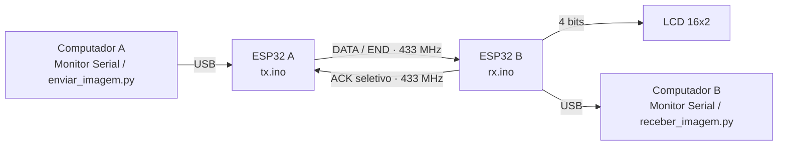
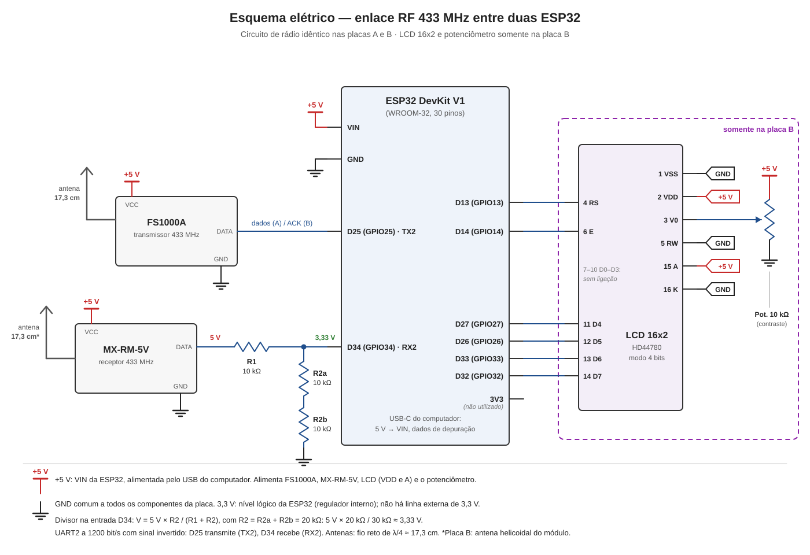
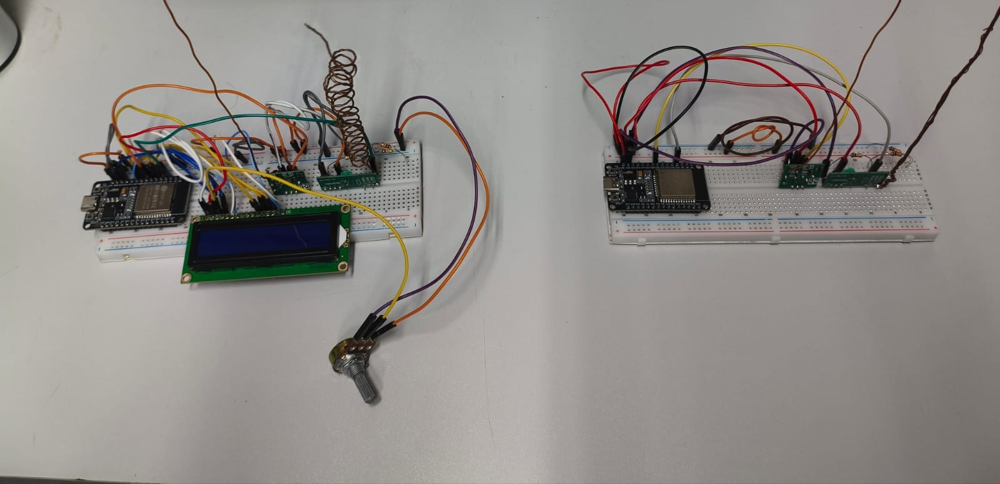
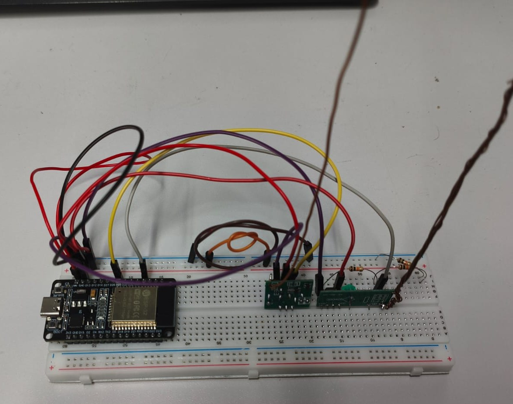
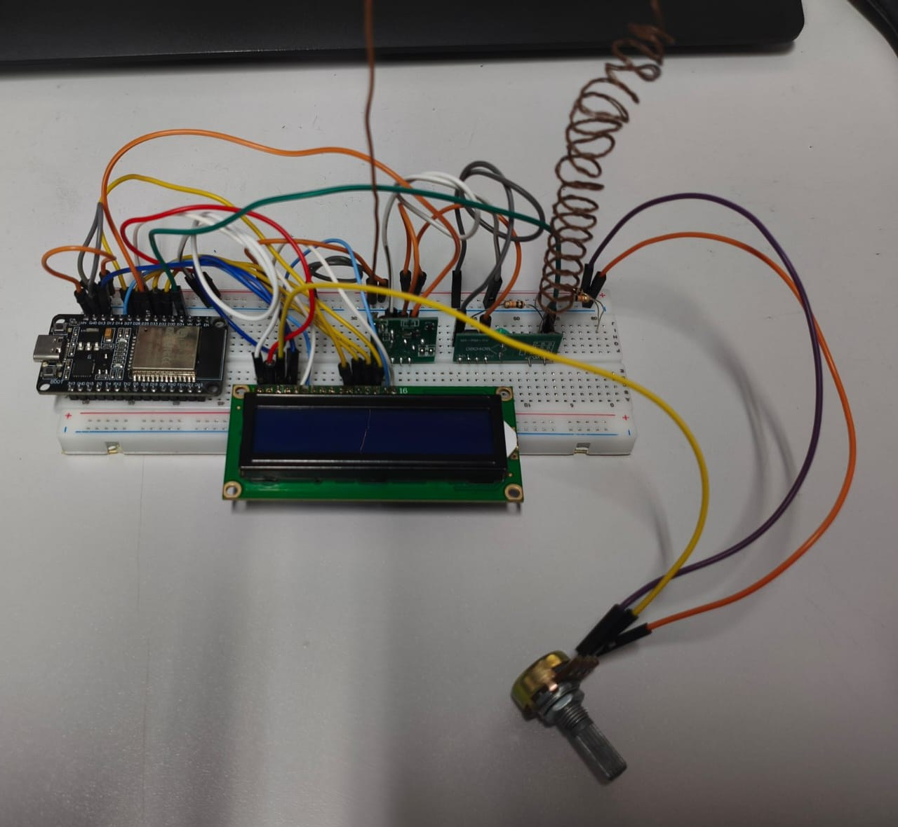
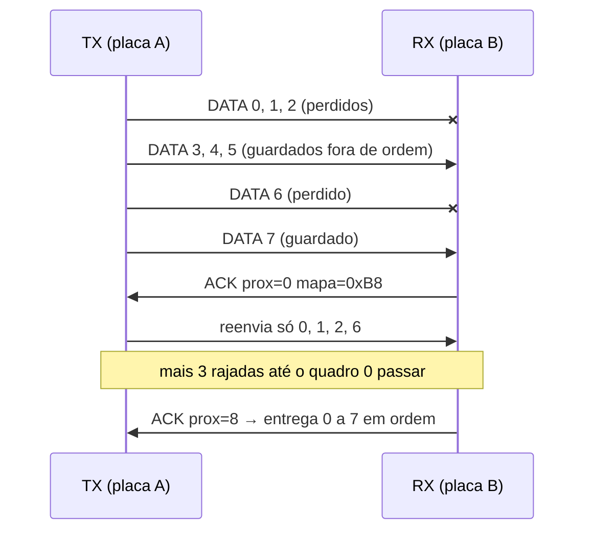
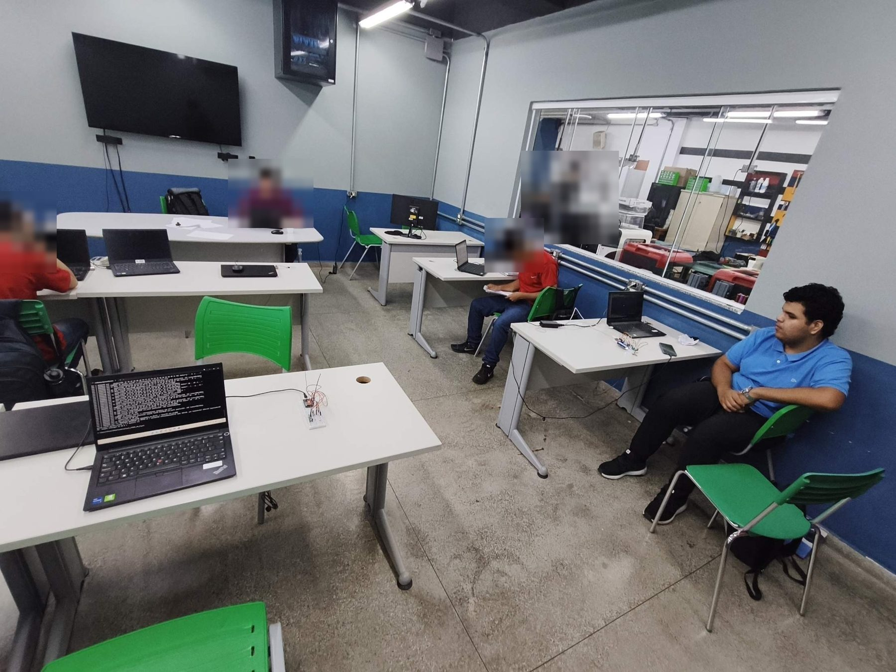
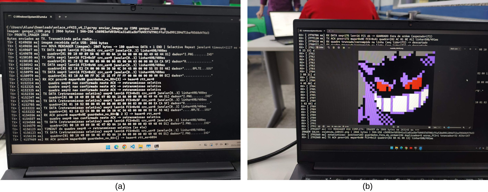
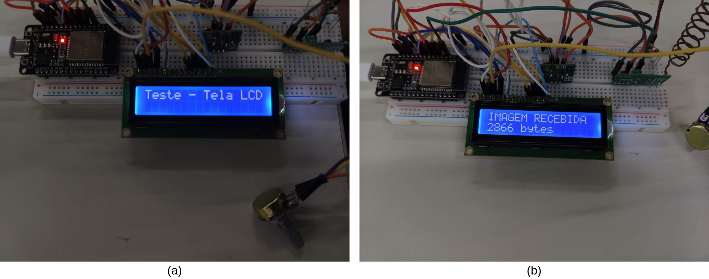

# Enlace RF 433 MHz confiável entre duas ESP32

**CRC-8 + Selective Repeat ARQ sobre rádio OOK bruto, sem RadioHead.**

Projeto final de **Transmissão e Comunicação de Dados** · Bacharelado em Engenharia da Computação · IFMT Campus Cuiabá – Cel. Octayde Jorge da Silva · 2026
Professor: Ruy de Oliveira · Equipe: Kauan Santos Rondon, Luis Fernando Amorim da Silva e Vinícius Campos Andrade Silva ([quem fez o quê](#9-equipe))

> **Documentação complementar:** [Relatório ABNT (PDF)](docs/relatorio/Relatorio_Enlace_RF433_ABNT.pdf) · [Arquitetura e protocolo](docs/arquitetura.md) · [Guia de reprodução](docs/reproducao.md) · [Montagem](docs/montagem.md) · [Resultados](docs/resultados.md)
>
> Todo o conteúdo do projeto está nesta página; as pastas guardam os arquivos originais (código, logs, CSVs, imagens) e cada seção aponta para eles.

## Sumário

1. [Visão geral](#1-visão-geral)
2. [Resultados e métricas](#2-resultados-e-métricas)
   - [Requisitos do enunciado](#requisitos-do-enunciado)
3. [Arquitetura e funcionamento](#3-arquitetura-e-funcionamento)
   - [3.1 Montagem](#31-montagem) · [3.2 Quadro e tempos](#32-quadro-e-tempos) · [3.3 Cálculo do FCS (CRC-8)](#33-cálculo-do-fcs-crc-8) · [3.4 Camada física](#34-camada-física) · [3.5 Selective Repeat](#35-selective-repeat) · [3.6 Firmware e comandos](#36-firmware-e-comandos)
4. [Como reproduzir](#4-como-reproduzir)
5. [Testes e validação](#5-testes-e-validação)
   - [5.1 Resultados da bancada](#51-resultados-da-bancada) · [5.2 Logs do Monitor Serial](#52-logs-do-monitor-serial) · [5.3 Imagem reconstruída](#53-imagem-reconstruída) · [5.4 Simulador](#54-simulador) · [5.5 Dois computadores](#55-ensaios-com-dois-computadores-2311)
6. [Problemas encontrados e decisões de projeto](#6-problemas-encontrados-e-decisões-de-projeto)
7. [Estrutura do repositório](#7-estrutura-do-repositório)
8. [Referências](#8-referências)
9. [Equipe](#9-equipe)

---

## 1. Visão geral

A placa **A** transmite texto e imagens pelo rádio de 433 MHz. A placa **B** confere cada quadro com **CRC-8**, mostra o texto num **LCD 16x2**, entrega a imagem ao computador e devolve **ACKs seletivos**. Os dados vão de A para B; as confirmações voltam de B para A. Nenhum fio liga as placas: toda a comunicação é pelo rádio.



| Camada | O que faz | Onde está |
|---|---|---|
| Aplicação | Texto (Monitor Serial → LCD) e imagem (script Python → arquivo) | [`firmware/`](firmware/), [`pc/`](pc/) |
| Controle de erros | Selective Repeat, janela 4 (1 a 8) | [Seção 3.5](#35-selective-repeat) |
| Detecção de erros | CRC-8, polinômio 0x07 | [Seção 3.3](#33-cálculo-do-fcs-crc-8) |
| Quadro | FLAG, TYPE, SEQ, LEN, DATA, FCS | [Seção 3.2](#32-quadro-e-tempos) |
| Física | UART 1200 bit/s invertida, preâmbulo, Manchester, rádio OOK | [Seção 3.4](#34-camada-física) |

---

## 2. Resultados e métricas

Bateria de 36 testes em 21/11/2026 e bateria de 21 testes com uma placa em cada computador em 23/11/2026, 3 repetições por cenário. Detalhes nas Seções [5.1](#51-resultados-da-bancada) e [5.5](#55-ensaios-com-dois-computadores-2311).

| Indicador | Resultado |
|---|---|
| Mensagens entregues | **33 de 36** em 21/11 · **19 de 21** com dois computadores em 23/11 |
| Mensagens entregues com erro | **0** |
| Imagens com SHA-256 igual ao original | **8 de 8** (6 em 21/11 + 2 com dois computadores a 1,8 m, até 2866 bytes) |
| Maior distância testada | **2 m**, 3 de 3 entregues |
| Quadros com erro descartados | 57 pelo CRC-8 · 186 pela decodificação Manchester |
| Tempo do CRC-8 na ESP32 | **8 µs** por quadro (mediana de 1252 medições; `/bench`: 7,79 µs em 10 000 repetições) |
| Selective Repeat (janela 8) × Stop-and-Wait | **56% mais rápido** em 21/11 (18,1 s × 41,5 s) · **67%** com dois computadores (12,7 s × 38,9 s) |

Todas as falhas (3 em 21/11, 2 a 2 m em 23/11) foram abandonadas pelo transmissor depois de 20 s sem confirmação. O protocolo nunca entregou dado errado: **54 de 54** entregas chegaram idênticas ao enviado.

### Requisitos do enunciado

| Requisito | Situação | Onde ver |
|---|---|---|
| Duas ESP32 com módulos RF 433 MHz (2 TX e 2 RX) | ✅ | [Seção 3.1](#31-montagem) (esquema elétrico e fotos) |
| Transmissão RF bruta, sem RadioHead | ✅ | [Seção 3.4](#34-camada-física) |
| Quadro FLAG, TYPE, SEQ, LEN, DATA (0–16), FCS; máx. 21 bytes | ✅ | [Seção 3.2](#32-quadro-e-tempos) |
| Somente quadros DATA, ACK e END | ✅ | [Seção 3.2](#32-quadro-e-tempos) |
| Detecção de erros: **CRC** (3 pts) | ✅ CRC-8 | [Seção 3.3](#33-cálculo-do-fcs-crc-8) |
| Controle de erros: **Selective Repeat** (3 pts) | ✅ ACK com mapa de bits | [Seção 3.5](#35-selective-repeat) |
| LCD no receptor mostrando o texto | ✅ | [Seção 5.5](#55-ensaios-com-dois-computadores-2311) |
| Troca de texto e imagens entre os laptops | ✅ uma placa em cada notebook | [Seções 5.3](#53-imagem-reconstruída) e [5.5](#55-ensaios-com-dois-computadores-2311) |
| Comunicação a mais de 1 m | ✅ até 2 m; estável até 1,5 m com dois computadores | [Seções 5.1.1](#511-distância) e [5.5](#55-ensaios-com-dois-computadores-2311) |
| Funciona com ruído | ✅ celular encostado no receptor | [Seção 5.1.3](#513-erros-perdas-e-ruído) |
| Comunicação apenas via RF | ✅ nenhum fio de dados entre as placas | [Seção 1](#1-visão-geral) |
| Dado chega em perfeito estado | ✅ 54 de 54 entregas sem erro | [Seções 5.1](#51-resultados-da-bancada) e [5.5](#55-ensaios-com-dois-computadores-2311) |
| Código no GitHub | ✅ | [`firmware/`](firmware/) |
| Documento completo | ✅ | esta página + [relatório em PDF](docs/relatorio/Relatorio_Enlace_RF433_ABNT.pdf) |
| Descrição do cálculo do FCS | ✅ | [Seção 3.3](#33-cálculo-do-fcs-crc-8) |
| Logs do Monitor Serial | ✅ 72 arquivos | [Seção 5.2](#52-logs-do-monitor-serial) |
| Imagem reconstruída no laptop receptor | ✅ SHA-256 idêntico | [Seções 5.3](#53-imagem-reconstruída) e [5.5](#55-ensaios-com-dois-computadores-2311) |

---

## 3. Arquitetura e funcionamento

### 3.1 Montagem

#### Esquema elétrico

Circuito completo de uma placa, fio a fio. O rádio é igual nas placas A e B; o LCD e o potenciômetro (área tracejada) ficam só na placa B. Arquivo vetorial: [`docs/esquema_eletrico.svg`](docs/esquema_eletrico.svg).



#### Fotos

| Bancada: placa B (receptor) e placa A (transmissor) |
|---|
|  |

| Placa A — transmissor | Placa B — receptor com LCD |
|---|---|
|  |  |

#### Materiais

| Item | Qtd. | Observação |
|---|---|---|
| ESP32 DevKit V1 (WROOM-32, 30 pinos, USB-C) | 2 | Uma por lado |
| Transmissor RF 433 MHz FS1000A | 2 | Um por placa |
| Receptor RF 433 MHz MX-RM-5V (XY-MK-5V) | 2 | Um por placa |
| LCD 16x2 paralelo (HD44780) | 1 | Só na placa B |
| Potenciômetro 10 kΩ (B10K) | 1 | Contraste do LCD |
| Resistor 10 kΩ | 6 | 3 por placa (divisor de tensão) |
| Fio rígido de 17,3 cm | 4 | Antena de cada módulo |
| Protoboard de 830 furos | 2 | |
| Jumpers macho-macho | ~30 | |
| Jumpers macho-fêmea | 3 | Ligação do potenciômetro, cujos terminais não encaixam na protoboard |

#### Ligações (iguais nas duas placas)

| ESP32 | Liga em | Função |
|---|---|---|
| VIN (5 V do USB) | VCC do FS1000A e do MX-RM-5V | Alimentação dos rádios |
| GND | GND dos dois módulos | Referência |
| D25 (GPIO25) | DATA do FS1000A | Saída para o rádio (TX da UART2) |
| D34 (GPIO34) | DATA do MX-RM-5V **pelo divisor** | Entrada do rádio (RX da UART2) |

A ordem VCC/DATA/GND muda entre fabricantes: siga a serigrafia de cada módulo. No MX-RM-5V, os dois pinos do meio são DATA.

#### LCD (só placa B, modo 4 bits)

| Pino do LCD | Liga em |
|---|---|
| 1 VSS, 5 RW, 16 K | GND |
| 2 VDD, 15 A | 5 V |
| 3 V0 | Pino do meio do potenciômetro (pontas no 5 V e no GND) |
| 4 RS · 6 E | D13 · D14 |
| 11 D4 · 12 D5 · 13 D6 · 14 D7 | D27 · D26 · D33 · D32 |
| 7 a 10 (D0–D3) | Sem ligação |

#### Divisor de tensão e antena

O receptor precisa de 5 V e sua saída também chega a 5 V; o GPIO da ESP32 aceita no máximo 3,3 V.

```
DATA do receptor ── 10 kΩ ──┬── D34          V(D34) = 5 V × 20 kΩ / 30 kΩ = 3,33 V
                          10 kΩ
                          10 kΩ
                           GND
```

Antena: fio reto de ¼ de onda soldado no furo ANT de cada módulo: λ/4 = 3×10⁸ / (4 × 433,92×10⁶) ≈ **17,3 cm**. Nos testes, as antenas ficaram retas, na vertical e paralelas.

#### Cuidados que fizeram diferença na bancada

- Alimente as placas por notebook (de preferência na bateria) ou carregador de tomada. Um desktop ao lado da placa derrubou o alcance para 60–70 cm.
- Deixe as placas a pelo menos 30 cm do computador e o celular longe do receptor.
- Aperte bem os módulos na protoboard: os pinos são curtos e um mau contato causa falhas intermitentes.

Detalhes: [`docs/montagem.md`](docs/montagem.md).

### 3.2 Quadro e tempos

Quadro igual à Figura 2 do enunciado, com no máximo 21 bytes:

| Campo | Tamanho | Conteúdo |
|---|---|---|
| FLAG | 1 byte | `0x7E`, início do quadro |
| TYPE | 1 byte | `0x01` DATA · `0x02` ACK · `0x03` END |
| SEQ | 1 byte | Número de sequência, 0 a 255 |
| LEN | 1 byte | Bytes em DATA, 0 a 16 |
| DATA | 0 a 16 bytes | Carga útil |
| FCS | 1 byte | CRC-8 de TYPE, SEQ, LEN e DATA |

| Tipo | Uso |
|---|---|
| DATA | Até 16 bytes da mensagem. O 1º byte da mensagem indica o conteúdo: `T` texto, `I` imagem |
| ACK | SEQ = **próximo quadro esperado** em ordem · LEN = 1 · DATA[0] = **mapa de bits** dos quadros já guardados à frente |
| END | Fim da mensagem (LEN = 0). Só sai depois que todos os DATA foram confirmados |

Qualquer TYPE diferente desses três, ou LEN maior que 16, faz o quadro ser descartado.

Quadro real, tirado do log do TX:

```
FLAG TYPE SEQ LEN  DATA (16 bytes)                                   FCS
 7E   01   00  10  54 41 42 43 44 45 46 47 48 49 4A 4B 4C 4D 4E 4F   42
                   T  A  B  C  D  E  F  G  H  I  J  K  L  M  N  O
```

#### Tempos do protocolo

Calculados no código a partir da taxa (arquivo `protocolo_rf.h`):

| Parâmetro | Fórmula | Valor a 1200 bit/s |
|---|---|---|
| 1 byte na linha | 10 bits / 1200 | 8,33 ms |
| DATA com 16 bytes | 8 + 1 + 2·20 bytes | 49 B · 408 ms |
| END | 8 + 1 + 2·4 bytes | 17 B · 142 ms |
| ACK | 48 + 1 + 2·5 bytes | 59 B · 492 ms |
| Silêncio antes do ACK | (8 + 4)·8,33 + 25 + 300 | 425 ms |
| Timeout de cada quadro | 425 + 492 + 200 | 1117 ms |
| Intervalo entre mensagens | timeout + 300 | 1417 ms |
| TX desiste | sem confirmação nova | 20 s |
| RX descarta mensagem incompleta | sem quadro válido | 26 s |

### 3.3 Cálculo do FCS (CRC-8)

| Parâmetro | Valor |
|---|---|
| Polinômio gerador | x⁸ + x² + x + 1 (`0x07`) |
| Valor inicial | `0x00` |
| Reflexão de bits / XOR final | não / `0x00` |
| Campos cobertos | TYPE, SEQ, LEN, DATA (FLAG e FCS ficam de fora) |
| Equivalente catalogado | CRC-8/SMBUS (verificação: `"123456789"` → `0xF4`) |

O CRC trata os bits como coeficientes de um polinômio M(x) sobre GF(2), onde soma e subtração são XOR. O FCS é o resto:

$$
R(x) = \left[ M(x) \cdot x^{8} \right] \bmod G(x), \qquad G(x) = x^{8} + x^{2} + x + 1
$$

```cpp
inline uint8_t crc8(const uint8_t *p, size_t n) {
  uint8_t crc = 0x00;
  for (size_t i = 0; i < n; ++i) {
    crc ^= p[i];                                   // entra o próximo byte
    for (uint8_t b = 0; b < 8; ++b)                // 8 passos da divisão polinomial
      crc = (crc & 0x80) ? uint8_t((crc << 1) ^ 0x07) : uint8_t(crc << 1);
  }
  return crc;                                      // resto = FCS
}
```

A cada byte, o registrador recebe o byte por XOR e faz 8 deslocamentos. Quando o bit que sai é 1, aplica XOR com `0x07`: é a divisão polinomial feita bit a bit.

**Exemplo passo a passo:** quadro DATA, SEQ 0, texto `"Oi"`; bytes protegidos `01 00 02 4F 69`.

| Byte | Depois do XOR | Depois dos 8 passos |
|---|---|---|
| `01` TYPE | `01` | `07` |
| `00` SEQ | `07` | `15` |
| `02` LEN | `17` | `65` |
| `4F` 'O' | `2A` | `D6` |
| `69` 'i' | `BF` | **`34`** |

O TX envia FCS = `0x34`. O RX recalcula sobre o que recebeu: se der `0x34`, aceita; senão, descarta.

**Detecção real** (teste `/erro 30`): o byte `0x59` chegou como `0xD9` (bit 7 invertido) e o CRC acusou:

```
RX quadro DATA seq=6: FCS recebido=0x07 calculado=0x33
   quadro=[01 06 10 52 53 54 55 56 57 58 D9 5A 41 42 43 44 45 46 47 07] -> ERRO DETECTADO, descartado
```

**O que esse CRC-8 garante:** detecta todo erro de 1 bit, todo erro com número ímpar de bits (G(x) tem 4 termos, logo o fator x + 1) e toda rajada de até 8 bits. Um erro só passa se o padrão de erro for múltiplo de G(x), cerca de 1 em 256 para erros aleatórios.

**Custo medido na ESP32:**

| Medida | Amostras | Mediana | Média | Máximo |
|---|---|---|---|---|
| Cálculo no TX (`crc_us`) | 1252 | 8 µs | 8,1 µs | 22 µs |
| Verificação no RX (`verif_us`) | 694 | 8 µs | 7,9 µs | 13 µs |

Um quadro leva 408 ms no ar, então o custo do CRC é desprezível.

### 3.4 Camada física

O enunciado proíbe bibliotecas de rádio, então a forma de levar o quadro pelo ar está no próprio código:

```
[ preâmbulo 0xF0 × 8 (× 48 no ACK) ] [ FLAG 0x7E ] [ TYPE SEQ LEN DATA FCS, cada byte → 2 bytes Manchester ]
```

1. **UART2 a 1200 bit/s no pino DATA do rádio.** O módulo é OOK: nível 1 liga a portadora. A 2400 bit/s o receptor deformava os pulsos e o alcance caía para ~70 cm.
2. **UART invertida.** Sem isso, o repouso da UART (nível 1) deixaria a portadora sempre ligada, e o ACK da outra placa nunca passaria.
3. **Preâmbulo `0xF0`.** Dá tempo ao controle de ganho do receptor. Na linha vira `0000011111`: metade 0, metade 1, e uma borda de descida por byte, onde a UART do receptor se alinha.
4. **FLAG `0x7E`** marca o início do quadro.
5. **Manchester por nibble:** bit 1 → `10`, bit 0 → `01`. Cada byte vira 2 bytes, sempre com quatro bits 1, porque o receptor é AC-acoplado e precisa de sinal equilibrado. Só 16 dos 256 valores são válidos; um byte inválido descarta o quadro na hora ("truncado"), antes mesmo do CRC.
6. **Eco:** o receptor de cada placa ouve o próprio transmissor. Depois de transmitir, o código descarta esses bytes.

O canal é **half-duplex**: os dois rádios usam 433,92 MHz. Por isso o TX envia uma rajada e para para ouvir. O ACK tem preâmbulo maior (48 bytes) e espera 300 ms extras porque o receptor da placa A, a centímetros do próprio transmissor, fica "ofuscado" logo depois de transmitir.

Com `/erro P`, o TX inverte um bit **depois** do CRC e **antes** do Manchester: o erro chega com Manchester válido e só o CRC pode pegá-lo. É assim que o CRC é demonstrado isoladamente.

### 3.5 Selective Repeat

| Protocolo | Quadros em trânsito | Quando um quadro se perde | Pontos |
|---|---|---|---|
| Stop-and-Wait | 1 | Retransmite esse quadro | 1 |
| Go-Back-N | até N | Retransmite esse **e todos os seguintes** | 2 |
| **Selective Repeat** | até N | Retransmite **só esse**; o RX guarda os fora de ordem | **3** |

**Transmissor (placa A)**

1. Divide a mensagem em quadros DATA de até 16 bytes, numerados de 0.
2. Envia uma rajada de até W quadros novos (W = 4; 1 a 8 com `/janela N`) e para para ouvir.
3. Ao receber um ACK, marca como confirmados os quadros antes de SEQ e os indicados no mapa de bits.
4. Quadro enviado antes desse ACK e que não aparece nele se perdeu: é retransmitido na hora (o ACK seletivo faz papel de **NAK**).
5. Sem ACK, cada quadro tem seu temporizador (1117 ms); quando estoura, só aquele quadro é retransmitido.
6. Com todos os DATA confirmados, envia END e espera ACK com SEQ = END + 1.

**Receptor (placa B)**

1. Janela de 8 posições a partir do próximo SEQ esperado.
2. Quadro na janela e com CRC correto: guarda. Se for o esperado, entrega em ordem ele e os seguintes já guardados.
3. Quadro já entregue: descarta e repete o ACK (o anterior se perdeu).
4. Após 425 ms de silêncio, envia **um ACK por rajada**: SEQ = próximo esperado; DATA[0] = mapa (bit i = quadro SEQ + i guardado).
5. END em ordem: entrega a mensagem (texto no LCD e no Monitor; imagem ao computador).

Com SEQ de 8 bits, o Selective Repeat exige janela ≤ 2⁷ = 128; o máximo usado é 8 (tamanho do mapa de bits).

#### Exemplo real (teste janela 8, repetição 1)

O ACK `prox=0 mapa=0xB8` = 1011 1000₂ diz que o RX já tem os quadros 3, 4, 5 e 7. Só os que faltam voltam ao ar:

| Rajada | Q0 | Q1 | Q2 | Q3 | Q4 | Q5 | Q6 | Q7 | Resposta do RX |
|---|---|---|---|---|---|---|---|---|---|
| 1ª: 8 novos | ❌ | ❌ | ❌ | ✅ | ✅ | ✅ | ❌ | ✅ | ACK 0xB8: tem 3, 4, 5, 7 |
| 2ª: reenvia 0, 1, 2, 6 | ❌ | ✅ | ❌ | | | | ❌ | | ACK 0xBA: + 1 |
| 3ª: reenvia 0, 2, 6 | ❌ | | ✅ | | | | ✅ | | ACK 0xFE: + 2 e 6 |
| 4ª: reenvia 0 | ❌ | | | | | | | | sem resposta |
| 5ª: 0 de novo (timeout) | ✅ | | | | | | | | **ACK prox=8: entrega 0 a 7** |

✅ chegou com CRC ok · ❌ perdido ou truncado no canal · vazio = não enviado nessa rajada.
Foram 9 retransmissões; o Go-Back-N reenviaria os 8 quadros a cada rodada (32).



**Casos de borda tratados**

- ACK do END perdido: o RX reconhece o END repetido e confirma de novo, sem entregar duas vezes.
- ACK atrasado de mensagem anterior: 1417 ms entre mensagens, e cada mensagem recomeça em SEQ 0.
- Enlace caiu: o TX desiste em 20 s e o RX descarta em 26 s; os dois recomeçam juntos em SEQ 0.
- Problema dos dois generais: se o último ACK sempre se perder, o RX entrega e o TX registra "abandonada". O dado nunca chega duplicado nem corrompido.

### 3.6 Firmware e comandos

| Arquivo | Placa | O que faz |
|---|---|---|
| [`firmware/tx/protocolo_rf.h`](firmware/tx/protocolo_rf.h) e [`firmware/rx/protocolo_rf.h`](firmware/rx/protocolo_rf.h) | as duas (cópias idênticas) | Tempos, quadro, CRC-8, Manchester, montagem da linha, receptor de linha |
| [`firmware/tx/tx.ino`](firmware/tx/tx.ino) | A | Divide a mensagem, Selective Repeat do TX, simulação de erro e perda, imagem pelo USB |
| [`firmware/rx/rx.ino`](firmware/rx/rx.ino) | B | Janela do RX, entrega em ordem, ACKs, LCD, saída da imagem |

| Comando no Monitor Serial | Placa | Função |
|---|---|---|
| texto + Enter | TX | Envia o texto |
| `/janela N` | TX | Janela de 1 a 8 (1 = Stop-and-Wait) |
| `/erro P` | TX | Inverte 1 bit em P% dos quadros, depois do CRC |
| `/perda P` | TX | Deixa de transmitir P% dos quadros |
| `/teste N` | TX | Mensagem de teste com N caracteres |
| `/cancela` | TX | Abandona a mensagem atual |
| `/status` · `/resumo` · `/bench` | as duas | Estado · totais desde que ligou · tempo médio do CRC em 10.000 cálculos |
| `/reinicia` | RX | Volta a esperar SEQ 0 |

---

## 4. Como reproduzir

```bash
git clone https://github.com/kauanSR-DEv/enlace-rf433-esp32.git
cd enlace-rf433-esp32
```

**Ambiente:** Arduino IDE 2 com o pacote esp32 (Espressif), placa *ESP32 Dev Module*, biblioteca LiquidCrystal (inclusa). Python 3 com pyserial.

1. Monte as duas placas ([Seção 3.1](#31-montagem)).
2. Grave `firmware/tx/tx.ino` na placa A e `firmware/rx/rx.ino` na placa B. Cada pasta tem seu `.ino` e o `protocolo_rf.h`. Se a gravação falhar com *"Unable to verify flash chip connection"*, use Upload Speed = 115200.
3. Abra o Monitor Serial (115200 baud, *Nova linha*) e aperte **EN**. As duas placas devem mostrar:

```
TX pronto (v4.1) | RF 1200 bit/s | CRC-8 (0x07) | Selective Repeat janela=4 | timeout=1117 ms
RX pronto (v4.1) | RF 1200 bit/s | CRC-8 (0x07) | Selective Repeat janela=8 | ACK apos 425 ms de silencio
```

4. Digite `ola` no TX. O RX mostra `TEXTO: ola` e o LCD mostra `ola`.
5. **Imagem** (feche os Monitores Seriais; comece pelo receptor):

```bash
py -m pip install -r pc/requirements.txt
py pc/receber_imagem.py COM6                    # computador B
py pc/enviar_imagem.py COM5 pc/teste_32x32.png  # computador A
```

O receptor salva `recebida_HHMMSS.png` e mostra o SHA-256 para comparar com o original.

6. **Bateria de testes automática:**

```bash
# as duas placas no mesmo computador
py pc/coletar_testes.py --modo unico --tx COM5 --rx COM6

# uma placa em cada computador
py pc/coletar_testes.py --modo rx --rx COM6        # computador B, primeiro
py pc/coletar_testes.py --modo tx --tx COM5        # computador A
py pc/coletar_testes.py --modo juntar --pasta-tx evidencias/TX_... --pasta-rx evidencias/RX_...
```

O script pede para posicionar as placas antes de cada distância e grava `resultados.csv`, `resumo_por_cenario.csv`, `resumo.txt`, os logs e as imagens em `evidencias/<data_hora>/`. Opções: `--rapido` (1 repetição) e `--grupos distancia,janela,erro,ruido,imagem`.

<details>
<summary><b>Problemas comuns</b></summary>

| Sintoma | Causa provável | O que fazer |
|---|---|---|
| Nada chega, nem de perto | Versões ou taxas diferentes | Conferir a linha `pronto (v4.1) \| RF 1200 bit/s` nas duas |
| RX recebe, mas o TX repete o mesmo quadro | ACK não volta: mau contato no receptor da placa A ou no transmissor da placa B, ou ruído perto deles | Apertar os módulos; afastar placas de computadores e celulares |
| Falhas intermitentes sem mudar nada | Ruído da alimentação (desktop, carregador ruim) | Notebook na bateria ou carregador de tomada de boa qualidade |
| `ruido_descartado` do TX parado em `/status` | Receptor não entrega nada ao GPIO34 | Conferir 5 V, divisor e o pino DATA |
| LCD só com quadrados | Contraste | Girar o potenciômetro |
| Erro de compilação | `protocolo_rf.h` antigo na pasta do sketch | Copiar o do repositório para as duas pastas |
| `python` abre a Microsoft Store | Atalho do Windows | Usar `py` no lugar de `python` |

</details>

Passo a passo detalhado: [`docs/reproducao.md`](docs/reproducao.md).

---

## 5. Testes e validação

### 5.1 Resultados da bancada

**Condições:** 21/11/2026, 12h58 às 13h47, firmware v4.1, ambiente interno. As duas placas no mesmo notebook (na bateria), para o script gravar os logs do TX e do RX no mesmo relógio; o USB só alimenta e registra, sem nenhum fio de dados entre as placas. Os grupos de distância e janela foram repetidos com uma placa em cada computador em 23/11 ([Seção 5.5](#55-ensaios-com-dois-computadores-2311)). Demais condições: antenas retas e verticais; distância de antena a antena. Mensagem de teste `/teste 200` = 201 bytes = 13 quadros DATA + END (ruído: 500 caracteres; imagem: PNG 32×32 de 490 bytes). Tempo e retransmissões = média dos testes **entregues**.

Arquivos originais: [`evidencias/2026-11-21_1258/`](evidencias/2026-11-21_1258/) ([`resultados.csv`](evidencias/2026-11-21_1258/resultados.csv) · [`resumo_por_cenario.csv`](evidencias/2026-11-21_1258/resumo_por_cenario.csv) · [`resumo.txt`](evidencias/2026-11-21_1258/resumo.txt)).

#### 5.1.1 Distância

| Distância | Entregues | Tempo médio | Retransmissões | ACKs enviados pelo RX / recebidos pelo TX |
|---|---|---|---|---|
| 0,5 m | 3 de 3 | 10,3 s | 0 | 15 / 15 |
| 1,0 m | 2 de 3 | 13,9 s | 2,5 | 24 / 12 |
| 1,5 m | 2 de 3 | 29,9 s | 18 | 37 / 19 |
| 2,0 m | 3 de 3 | 19,8 s | 8 | 22 / 20 |

O enlace funcionou até 2 m, o dobro do exigido. A 1 m e a 1,5 m, metade dos ACKs se perdeu na volta (placa B → placa A): os dados chegavam, a confirmação não. O desempenho não cai de forma regular com a distância porque, dentro de casa, a posição exata das placas (reflexões, objetos próximos) pesa tanto quanto a distância.

#### 5.1.2 Janela: Stop-and-Wait × Selective Repeat

Modelo de canal limpo: cada quadro cheio ocupa ~437 ms e cada rajada termina com ~900 ms de espera pelo ACK.

$$
T \approx \sum_{\text{rajadas}} \left( k \cdot 437\ \text{ms} + 900\ \text{ms} \right) + T_{END}
$$

Para janela 4, o modelo prevê 10,2 s; o medido a 0,5 m foi **10,26 s**.

| Janela | Teórico (canal limpo) | Média medida a 1 m | Melhor caso | Retransmissões |
|---|---|---|---|---|
| 1 (Stop-and-Wait) | 18,3 s | 41,5 s | 40,0 s | 15 |
| 4 | 10,2 s | 26,9 s | 18,8 s | 14 |
| 8 | 8,4 s | 18,1 s | 12,7 s | 9,7 |

Janela 8 foi **56% mais rápida** que Stop-and-Wait. No Stop-and-Wait, cada quadro paga ~900 ms de espera pelo ACK; com janela 8, essa espera é dividida entre 8 quadros. Os tempos medidos ficaram acima do teórico porque, nessa posição, o canal perdia quadros e ACKs.

#### 5.1.3 Erros, perdas e ruído

| Cenário | Entregues | Tempo médio | Retransmissões | Erros detectados pelo CRC no RX |
|---|---|---|---|---|
| `/erro 30` (bit invertido em 30% dos quadros) | 3 de 3 | 28,1 s | 14 | 17 |
| `/perda 30` (30% dos quadros não enviados) | 3 de 3 | 41,2 s | 38,3 | 0 |
| Ruído real (celular encostado no RX) | 2 de 3 | 46,9 s | 19 | 0 |

Na repetição 2 do ruído real, além do celular, uma mão cobriu a antena do RX. O canal ficou inutilizável e o TX abandonou a mensagem sem entregar nada errado.

#### 5.1.4 Detecção de erros

| Nível de descarte | Quadros | Origem |
|---|---|---|
| Manchester inválido ("truncado") | 186 | Erros reais do canal |
| CRC-8 diferente do calculado | 57 | Bits invertidos pelo `/erro` (83 no total; os demais não chegaram inteiros ao RX) |
| **Aceitos com erro** | **0** | — |

#### 5.1.5 Achado: o primeiro quadro de cada rajada sofre mais

Nos testes sem erro ou perda simulados, o primeiro quadro de cada rajada foi confirmado em **72%** das vezes (165 de 229), contra **93%** dos demais (482 de 516). O TX começa a rajada ~10 ms depois de receber o ACK, quando o receptor da placa B acabou de transmitir e ainda está com o ganho baixo. Melhoria possível: esperar ~300 ms após cada ACK antes da próxima rajada.

#### 5.1.6 Todos os 36 testes

<details>
<summary><b>Abrir a tabela completa, com link para o log de cada teste</b></summary>

| # | Cenário | Rep. | Dist. (m) | Janela | Resultado | Integridade | Tempo (s) | Envios | Retransm. (ACK / timeout) | ACKs recebidos | Erros CRC no RX | Log |
|---|---|---|---|---|---|---|---|---|---|---|---|---|
| 1 | distancia_0.5m | 1 | 0,50 | 4 | ENTREGUE | OK | 10,3 | 14 | 0 (0 / 0) | 5 | 0 | [TX](evidencias/2026-11-21_1258/logs/01_distancia_0.5m_rep1_TX.txt) · [RX](evidencias/2026-11-21_1258/logs/01_distancia_0.5m_rep1_RX.txt) |
| 2 | distancia_0.5m | 2 | 0,50 | 4 | ENTREGUE | OK | 10,3 | 14 | 0 (0 / 0) | 5 | 0 | [TX](evidencias/2026-11-21_1258/logs/02_distancia_0.5m_rep2_TX.txt) · [RX](evidencias/2026-11-21_1258/logs/02_distancia_0.5m_rep2_RX.txt) |
| 3 | distancia_0.5m | 3 | 0,50 | 4 | ENTREGUE | OK | 10,3 | 14 | 0 (0 / 0) | 5 | 0 | [TX](evidencias/2026-11-21_1258/logs/03_distancia_0.5m_rep3_TX.txt) · [RX](evidencias/2026-11-21_1258/logs/03_distancia_0.5m_rep3_RX.txt) |
| 4 | distancia_1.0m | 1 | 1,00 | 4 | FALHA | NAO_RECEBIDO | 25,3 | 36 | 24 (0 / 24) | 2 | 0 | [TX](evidencias/2026-11-21_1258/logs/04_distancia_1.0m_rep1_TX.txt) · [RX](evidencias/2026-11-21_1258/logs/04_distancia_1.0m_rep1_RX.txt) |
| 5 | distancia_1.0m | 2 | 1,00 | 4 | ENTREGUE | OK | 17,5 | 19 | 5 (0 / 5) | 5 | 0 | [TX](evidencias/2026-11-21_1258/logs/05_distancia_1.0m_rep2_TX.txt) · [RX](evidencias/2026-11-21_1258/logs/05_distancia_1.0m_rep2_RX.txt) |
| 6 | distancia_1.0m | 3 | 1,00 | 4 | ENTREGUE | OK | 10,3 | 14 | 0 (0 / 0) | 5 | 0 | [TX](evidencias/2026-11-21_1258/logs/06_distancia_1.0m_rep3_TX.txt) · [RX](evidencias/2026-11-21_1258/logs/06_distancia_1.0m_rep3_RX.txt) |
| 7 | distancia_1.5m | 1 | 1,50 | 4 | FALHA | NAO_RECEBIDO | 57,5 | 58 | 45 (2 / 43) | 5 | 0 | [TX](evidencias/2026-11-21_1258/logs/07_distancia_1.5m_rep1_TX.txt) · [RX](evidencias/2026-11-21_1258/logs/07_distancia_1.5m_rep1_RX.txt) |
| 8 | distancia_1.5m | 2 | 1,50 | 4 | ENTREGUE | OK | 24,6 | 28 | 14 (2 / 12) | 7 | 0 | [TX](evidencias/2026-11-21_1258/logs/08_distancia_1.5m_rep2_TX.txt) · [RX](evidencias/2026-11-21_1258/logs/08_distancia_1.5m_rep2_RX.txt) |
| 9 | distancia_1.5m | 3 | 1,50 | 4 | ENTREGUE | OK | 35,0 | 36 | 22 (4 / 18) | 7 | 0 | [TX](evidencias/2026-11-21_1258/logs/09_distancia_1.5m_rep3_TX.txt) · [RX](evidencias/2026-11-21_1258/logs/09_distancia_1.5m_rep3_RX.txt) |
| 10 | distancia_2.0m | 1 | 2,00 | 4 | ENTREGUE | OK | 21,7 | 26 | 12 (1 / 11) | 6 | 0 | [TX](evidencias/2026-11-21_1258/logs/10_distancia_2.0m_rep1_TX.txt) · [RX](evidencias/2026-11-21_1258/logs/10_distancia_2.0m_rep1_RX.txt) |
| 11 | distancia_2.0m | 2 | 2,00 | 4 | ENTREGUE | OK | 18,8 | 20 | 6 (2 / 4) | 7 | 0 | [TX](evidencias/2026-11-21_1258/logs/11_distancia_2.0m_rep2_TX.txt) · [RX](evidencias/2026-11-21_1258/logs/11_distancia_2.0m_rep2_RX.txt) |
| 12 | distancia_2.0m | 3 | 2,00 | 4 | ENTREGUE | OK | 18,8 | 20 | 6 (2 / 4) | 7 | 0 | [TX](evidencias/2026-11-21_1258/logs/12_distancia_2.0m_rep3_TX.txt) · [RX](evidencias/2026-11-21_1258/logs/12_distancia_2.0m_rep3_RX.txt) |
| 13 | janela_1_SAW | 1 | 1,00 | 1 | ENTREGUE | OK | 40,0 | 28 | 14 (0 / 14) | 14 | 0 | [TX](evidencias/2026-11-21_1258/logs/13_janela_1_SAW_rep1_TX.txt) · [RX](evidencias/2026-11-21_1258/logs/13_janela_1_SAW_rep1_RX.txt) |
| 14 | janela_1_SAW | 2 | 1,00 | 1 | ENTREGUE | OK | 43,1 | 30 | 16 (0 / 16) | 14 | 0 | [TX](evidencias/2026-11-21_1258/logs/14_janela_1_SAW_rep2_TX.txt) · [RX](evidencias/2026-11-21_1258/logs/14_janela_1_SAW_rep2_RX.txt) |
| 15 | janela_1_SAW | 3 | 1,00 | 1 | ENTREGUE | OK | 41,5 | 29 | 15 (0 / 15) | 14 | 0 | [TX](evidencias/2026-11-21_1258/logs/15_janela_1_SAW_rep3_TX.txt) · [RX](evidencias/2026-11-21_1258/logs/15_janela_1_SAW_rep3_RX.txt) |
| 16 | janela_4 | 1 | 1,00 | 4 | ENTREGUE | OK | 43,1 | 42 | 28 (7 / 21) | 9 | 0 | [TX](evidencias/2026-11-21_1258/logs/16_janela_4_rep1_TX.txt) · [RX](evidencias/2026-11-21_1258/logs/16_janela_4_rep1_RX.txt) |
| 17 | janela_4 | 2 | 1,00 | 4 | ENTREGUE | OK | 18,8 | 22 | 8 (1 / 7) | 6 | 0 | [TX](evidencias/2026-11-21_1258/logs/17_janela_4_rep2_TX.txt) · [RX](evidencias/2026-11-21_1258/logs/17_janela_4_rep2_RX.txt) |
| 18 | janela_4 | 3 | 1,00 | 4 | ENTREGUE | OK | 18,8 | 20 | 6 (2 / 4) | 7 | 0 | [TX](evidencias/2026-11-21_1258/logs/18_janela_4_rep3_TX.txt) · [RX](evidencias/2026-11-21_1258/logs/18_janela_4_rep3_RX.txt) |
| 19 | janela_8 | 1 | 1,00 | 8 | ENTREGUE | OK | 20,4 | 26 | 12 (8 / 4) | 7 | 0 | [TX](evidencias/2026-11-21_1258/logs/19_janela_8_rep1_TX.txt) · [RX](evidencias/2026-11-21_1258/logs/19_janela_8_rep1_RX.txt) |
| 20 | janela_8 | 2 | 1,00 | 8 | ENTREGUE | OK | 21,3 | 28 | 14 (10 / 4) | 7 | 0 | [TX](evidencias/2026-11-21_1258/logs/20_janela_8_rep2_TX.txt) · [RX](evidencias/2026-11-21_1258/logs/20_janela_8_rep2_RX.txt) |
| 21 | janela_8 | 3 | 1,00 | 8 | ENTREGUE | OK | 12,7 | 17 | 3 (1 / 2) | 4 | 0 | [TX](evidencias/2026-11-21_1258/logs/21_janela_8_rep3_TX.txt) · [RX](evidencias/2026-11-21_1258/logs/21_janela_8_rep3_RX.txt) |
| 22 | erro_sim_30 | 1 | 1,00 | 4 | ENTREGUE | OK | 29,7 | 31 | 17 (9 / 8) | 10 | 8 | [TX](evidencias/2026-11-21_1258/logs/22_erro_sim_30_rep1_TX.txt) · [RX](evidencias/2026-11-21_1258/logs/22_erro_sim_30_rep1_RX.txt) |
| 23 | erro_sim_30 | 2 | 1,00 | 4 | ENTREGUE | OK | 33,9 | 31 | 17 (5 / 12) | 9 | 8 | [TX](evidencias/2026-11-21_1258/logs/23_erro_sim_30_rep2_TX.txt) · [RX](evidencias/2026-11-21_1258/logs/23_erro_sim_30_rep2_RX.txt) |
| 24 | erro_sim_30 | 3 | 1,00 | 4 | ENTREGUE | OK | 20,7 | 22 | 8 (4 / 4) | 8 | 1 | [TX](evidencias/2026-11-21_1258/logs/24_erro_sim_30_rep3_TX.txt) · [RX](evidencias/2026-11-21_1258/logs/24_erro_sim_30_rep3_RX.txt) |
| 25 | perda_sim_30 | 1 | 1,00 | 4 | ENTREGUE | OK | 27,0 | 27 | 13 (3 / 10) | 8 | 0 | [TX](evidencias/2026-11-21_1258/logs/25_perda_sim_30_rep1_TX.txt) · [RX](evidencias/2026-11-21_1258/logs/25_perda_sim_30_rep1_RX.txt) |
| 26 | perda_sim_30 | 2 | 1,00 | 4 | ENTREGUE | OK | 22,8 | 32 | 18 (4 / 14) | 8 | 0 | [TX](evidencias/2026-11-21_1258/logs/26_perda_sim_30_rep2_TX.txt) · [RX](evidencias/2026-11-21_1258/logs/26_perda_sim_30_rep2_RX.txt) |
| 27 | perda_sim_30 | 3 | 1,00 | 4 | ENTREGUE | OK | 73,9 | 98 | 84 (9 / 75) | 12 | 0 | [TX](evidencias/2026-11-21_1258/logs/27_perda_sim_30_rep3_TX.txt) · [RX](evidencias/2026-11-21_1258/logs/27_perda_sim_30_rep3_RX.txt) |
| 28 | ruido_real | 1 | 1,00 | 4 | ENTREGUE | OK | 49,9 | 56 | 23 (13 / 10) | 19 | 0 | [TX](evidencias/2026-11-21_1258/logs/28_ruido_real_rep1_TX.txt) · [RX](evidencias/2026-11-21_1258/logs/28_ruido_real_rep1_RX.txt) |
| 29 | ruido_real | 2 | 1,00 | 4 | FALHA | NAO_RECEBIDO | 22,4 | 32 | 26 (1 / 25) | 1 | — | [TX](evidencias/2026-11-21_1258/logs/29_ruido_real_rep2_TX.txt) · [RX](evidencias/2026-11-21_1258/logs/29_ruido_real_rep2_RX.txt) |
| 30 | ruido_real | 3 | 1,00 | 4 | ENTREGUE | OK | 43,9 | 48 | 15 (7 / 8) | 16 | 0 | [TX](evidencias/2026-11-21_1258/logs/30_ruido_real_rep3_TX.txt) · [RX](evidencias/2026-11-21_1258/logs/30_ruido_real_rep3_RX.txt) |
| 31 | imagem_limpa | 1 | 1,00 | 4 | ENTREGUE | OK | 45,1 | 48 | 16 (7 / 9) | 16 | — | [TX](evidencias/2026-11-21_1258/logs/31_imagem_limpa_rep1_TX.txt) · [RX](evidencias/2026-11-21_1258/logs/31_imagem_limpa_rep1_RX.txt) |
| 32 | imagem_limpa | 2 | 1,00 | 4 | ENTREGUE | OK | 43,5 | 47 | 15 (7 / 8) | 16 | 0 | [TX](evidencias/2026-11-21_1258/logs/32_imagem_limpa_rep2_TX.txt) · [RX](evidencias/2026-11-21_1258/logs/32_imagem_limpa_rep2_RX.txt) |
| 33 | imagem_limpa | 3 | 1,00 | 4 | ENTREGUE | OK | 43,5 | 47 | 15 (7 / 8) | 16 | 0 | [TX](evidencias/2026-11-21_1258/logs/33_imagem_limpa_rep3_TX.txt) · [RX](evidencias/2026-11-21_1258/logs/33_imagem_limpa_rep3_RX.txt) |
| 34 | imagem_erro_30 | 1 | 1,00 | 4 | ENTREGUE | OK | 58,9 | 60 | 28 (13 / 15) | 19 | 10 | [TX](evidencias/2026-11-21_1258/logs/34_imagem_erro_30_rep1_TX.txt) · [RX](evidencias/2026-11-21_1258/logs/34_imagem_erro_30_rep1_RX.txt) |
| 35 | imagem_erro_30 | 2 | 1,00 | 4 | ENTREGUE | OK | 57,8 | 62 | 30 (10 / 20) | 17 | 14 | [TX](evidencias/2026-11-21_1258/logs/35_imagem_erro_30_rep2_TX.txt) · [RX](evidencias/2026-11-21_1258/logs/35_imagem_erro_30_rep2_RX.txt) |
| 36 | imagem_erro_30 | 3 | 1,00 | 4 | ENTREGUE | OK | 61,8 | 70 | 38 (19 / 19) | 22 | 16 | [TX](evidencias/2026-11-21_1258/logs/36_imagem_erro_30_rep3_TX.txt) · [RX](evidencias/2026-11-21_1258/logs/36_imagem_erro_30_rep3_RX.txt) |

</details>

### 5.2 Logs do Monitor Serial

Cada teste tem o log completo do TX e do RX em [`evidencias/2026-11-21_1258/logs/`](evidencias/2026-11-21_1258/logs/) (72 arquivos; o link de cada um está na [tabela da Seção 5.1.6](#516-todos-os-36-testes)). Cada linha começa com o tempo da placa em milissegundos, e cada quadro aparece com os bytes em hexadecimal, o FCS e o tempo do CRC.

**Mensagem a 0,5 m, sem retransmissões** ([TX](evidencias/2026-11-21_1258/logs/01_distancia_0.5m_rep1_TX.txt)):

```
=== NOVA MENSAGEM (texto): 201 bytes -> 13 quadros DATA + 1 END | Selective Repeat janela=4 timeout=1117 ms ===
TX DATA seq=0 len=16 FCS=0x42 crc_us=16 janela=[0..3] linha=49B/408ms
   quadro=[01 00 10 54 41 42 43 44 45 46 47 48 49 4A 4B 4C 4D 4E 4F 42] dados="TABCDEFGHIJKLMNO"
...
RX ACK prox=4 mapa=0x00 guardados_no_RX=[] -> base=4 rtt_ms=899
RX ACK prox=8 mapa=0x00 guardados_no_RX=[] -> base=8 rtt_ms=899
RX ACK prox=12 mapa=0x00 guardados_no_RX=[] -> base=12 rtt_ms=899
...
=== MENSAGEM ENTREGUE em 10263 ms | envios=14 retransmissoes=0 (por ACK=0, por timeout=0) ACKs=5 (ignorados=0) erros_sim=0 perdas_sim=0 | 19.6 bytes/s ===
```

**CRC detectando erros simulados** ([RX](evidencias/2026-11-21_1258/logs/22_erro_sim_30_rep1_RX.txt)):

```
RX DATA seq=5 len=16 FCS ok -> GUARDADO fora de ordem (esperado=4)
RX quadro DATA seq=6: FCS recebido=0x07 calculado=0x33 quadro=[01 06 10 52 53 54 55 56 57 58 D9 5A 41 42 43 44 45 46 47 07] -> ERRO DETECTADO, descartado
RX DATA seq=7 len=16 FCS ok -> GUARDADO fora de ordem (esperado=4)
...
RX quadro DATA seq=4: FCS recebido=0xF0 calculado=0xBF quadro=[01 04 10 4C 4D 4E 4F 50 51 52 53 54 55 5E 57 58 59 5A 41 F0] -> ERRO DETECTADO, descartado
```

**Retransmissão seletiva** ([TX](evidencias/2026-11-21_1258/logs/19_janela_8_rep1_TX.txt) · [RX](evidencias/2026-11-21_1258/logs/19_janela_8_rep1_RX.txt)):

```
RX ACK prox=0 mapa=0xB8 guardados_no_RX=[3 4 5 7] -> base=0 rtt_ms=0
   quadro seq=0 nao confirmado neste ACK -> retransmissao seletiva
   quadro seq=1 nao confirmado neste ACK -> retransmissao seletiva
   quadro seq=2 nao confirmado neste ACK -> retransmissao seletiva
   quadro seq=6 nao confirmado neste ACK -> retransmissao seletiva
TX DATA (retransmissao seletiva) seq=0 len=16 FCS=0x42 crc_us=9 janela=[0..7] linha=49B/408ms
```

**Mensagem abandonada** ([TX](evidencias/2026-11-21_1258/logs/04_distancia_1.0m_rep1_TX.txt)):

```
=== FALHA: MENSAGEM ABANDONADA em 25317 ms | envios=36 retransmissoes=24 (por ACK=0, por timeout=24) ACKs=2 (ignorados=0) erros_sim=0 perdas_sim=0 | 7.9 bytes/s ===
```

Alguns logs do TX começam com caracteres ilegíveis (`����`): são bytes inválidos que a porta USB entregou ao abrir. O script já foi corrigido para descartá-los. Mais detalhes em [`evidencias/README.md`](evidencias/README.md).

### 5.3 Imagem reconstruída

| Original (computador A) | Recebida pelo rádio (computador B) |
|---|---|
|  |  |
| [`pc/teste_32x32.png`](pc/teste_32x32.png) · 490 bytes | [`imagens/34_imagem_erro_30_rep1.png`](evidencias/2026-11-21_1258/imagens/34_imagem_erro_30_rep1.png) · recebida com `/erro 30` |

| Cenário | Entregues | Tempo médio | Retransmissões | Erros CRC | SHA-256 igual ao original |
|---|---|---|---|---|---|
| Imagem limpa | 3 de 3 | 44,1 s | 15,3 | 0 | 3 de 3 |
| Imagem com `/erro 30` | 3 de 3 | 59,5 s | 32 | 13,3 | 3 de 3 |

SHA-256 da original e das 6 recebidas: `80e0254066353f1ba5c001529b17b0036d4843329d59aee5de46a81e93f48204`. Para um arquivo binário, um único bit errado já estragaria a imagem. As 6 recebidas estão em [`evidencias/2026-11-21_1258/imagens/`](evidencias/2026-11-21_1258/imagens/).

### 5.4 Simulador

[`tests/`](tests/) roda o `tx.ino` e o `rx.ino` **sem alteração** no computador, ligados por um canal simulado com perdas e inversão de bits, para testar a lógica antes da bancada.

```bash
cd tests
cp ../firmware/tx/tx.ino ../firmware/rx/rx.ino ../firmware/tx/protocolo_rf.h .
g++ -std=c++17 -O2 -I. -o sim sim.cpp && ./sim 1
g++ -std=c++17 -O2 -I. -o sim_img sim_img.cpp && ./sim_img
```

Go-Back-N (versão anterior, em [`historico/`](historico/)) × Selective Repeat no simulador, média de 5 execuções, 300 caracteres, janela 4. O simulador não reproduz os tempos reais do rádio; compare as colunas entre si.

| Cenário | Go-Back-N | Selective Repeat | Ganho |
|---|---|---|---|
| Canal limpo | 4,5 s | 4,6 s | — |
| Erro de bit no canal | 35,7 s | 23,0 s | 36% |
| `/erro 30` | 39,3 s | 19,6 s | 50% |
| `/perda 30` | 30,4 s | 16,1 s | 47% |
| Perda de 40% | 40,9 s (desistiu em 4 de 5) | 32,9 s (entregou 5 de 5) | 20% |
| Perda 20% + erro, janela 8 | 38,1 s (desistiu em 3 de 5) | 20,5 s (entregou 5 de 5) | 46% |

### 5.5 Ensaios com dois computadores (23/11)

Uma placa em cada notebook, como pede o enunciado. Evidências completas em [`evidencias/2026-11-23_dois_computadores/`](evidencias/2026-11-23_dois_computadores/).

| Disposição: placa A e notebook A na frente, placa B e notebook B ao fundo |
|---|
|  |

#### Bateria de distância e janela (21 testes)

`coletar_testes.py --modo tx` no notebook A, `--modo rx` no notebook B e `--modo juntar` no fim (diferença entre os relógios estimada em 0,66 s). Mensagem `/teste 200` (201 bytes), 3 repetições. Arquivos: [`bateria/resultados.csv`](evidencias/2026-11-23_dois_computadores/bateria/resultados.csv) · [`resumo.txt`](evidencias/2026-11-23_dois_computadores/bateria/resumo.txt) · [`logs/`](evidencias/2026-11-23_dois_computadores/bateria/logs/) (42 arquivos, TX e RX de cada teste).

| Cenário | Entregues | Tempo médio | Retransmissões | ACKs perdidos no retorno |
|---|---|---|---|---|
| 0,5 m, janela 4 | 3 de 3 | 10,3 s | 0 | 0 |
| 1,0 m, janela 4 | 3 de 3 | 19,5 s | 6,7 | 0 |
| 1,5 m, janela 4 | 3 de 3 | 18,8 s | 6,0 | 0 |
| 2,0 m, janela 4 | **1 de 3** | 33,7 s | 17 | 0 na entrega; nas 2 falhas o RX não recebeu nada |
| 1 m, janela 1 (Stop-and-Wait) | 3 de 3 | 38,9 s | 13,3 | 1 |
| 1 m, janela 4 | 3 de 3 | 19,8 s | 7,3 | 1 |
| 1 m, janela 8 | 3 de 3 | 12,7 s | 3,0 | 0 |

- **19 de 21 entregues, todas idênticas.** Estável até 1,5 m; o limite dessa disposição fica entre 1,5 m e 2 m.
- **O ACK de volta deixou de ser o problema:** em 21/11 cerca de metade dos ACKs se perdia a 1–1,5 m; aqui só 2 se perderam na bateria inteira.
- **Janela 8 foi 67% mais rápida que Stop-and-Wait.** No Stop-and-Wait todo quadro é o primeiro da sua rajada, e ~13 dos 14 precisaram de retransmissão por *timeout*: o tempo praticamente dobrou em relação aos 18,3 s previstos para canal limpo. É o mesmo efeito do [achado 5.1.5](#515-achado-o-primeiro-quadro-de-cada-rajada-sofre-mais).

#### Imagens a 1,8 m

| Medida | PNG 32×32 | PNG 1280×1280 |
|---|---|---|
| Tamanho | 490 bytes (31 quadros + END) | 2866 bytes (180 quadros + END) |
| Tempo no receptor | 64,5 s | 263,1 s |
| Vazão útil | 7,6 bytes/s | 10,9 bytes/s (87 bit/s, ~7% dos 1200 bit/s da linha) |
| Quadros rejeitados pelo CRC | 0 | 1 (erro real do canal, sem `/erro`) |
| SHA-256 enviado = recebido | ✅ `80e02540…f48204` | ✅ `c56983ef…68d476d3` |

| SHA-256 no transmissor (a) e imagem reconstruída no receptor com o mesmo SHA-256 (b) |
|---|
|  |

| LCD da placa B: texto recebido (a) e aviso da imagem de 2866 bytes (b) |
|---|
|  |

Na mesma sessão (~78 min, incluindo tentativas de alcance acima de 1,7 m), o `/resumo` do TX registrou 63 mensagens, 50 entregues e 13 abandonadas, com 566 retransmissões: **495 por *timeout*** e 71 por lacuna no mapa de bits. Na distância limite, o que se perde é o ACK de volta. Nessa montagem o enlace foi estável até ~1,5 m e intermitente a partir de ~1,7 m.

---

## 6. Problemas encontrados e decisões de projeto

| Problema | Causa | Solução |
|---|---|---|
| ACK nunca chegava ao TX | Em repouso, a UART fica em nível 1 e o FS1000A transmitia o tempo todo | UART invertida: repouso = rádio desligado |
| Alcance de 70 a 80 cm | A 2400 bit/s o receptor deformava os pulsos | Taxa de 1200 bit/s |
| Dados chegavam, ACK não | Receptor da placa A "ofuscado" pelo próprio transmissor | 300 ms de silêncio antes do ACK e preâmbulo de 48 bytes no ACK |
| Falhas intermitentes com uma placa no desktop | Ruído da fonte e das portas USB do desktop, perto do receptor | Notebook na bateria e placas afastadas do computador |
| Ruído confundido com início de quadro | O receptor ocioso entrega bits aleatórios | Manchester (só 16 de 256 valores válidos) e LEN ≤ 16 |
| Saída do receptor em 5 V | O MX-RM-5V precisa de 5 V e a saída acompanha | Divisor 10 kΩ / 20 kΩ para 3,3 V |

**Limitações:** os testes foram feitos com as duas placas no mesmo notebook (sem fio de dados entre elas); a vazão útil é baixa (~20 bytes/s no melhor caso) porque o projeto priorizou alcance; 3 repetições por cenário mostram o comportamento, mas não dão uma taxa estatística precisa.

### Evolução das versões

| Versão | O que mudou | Por quê |
|---|---|---|
| v1–v2 | Quadro do enunciado, CRC-8, Go-Back-N, UART a 2400 bit/s invertida, preâmbulo, Manchester, LCD paralelo | Primeiras versões funcionais |
| v3 | 1200 bit/s, preâmbulo de 24 bytes no ACK, 100 ms de silêncio antes do ACK, envio de imagem | Alcance passou de 70–80 cm para ~2 m |
| v4 | **Selective Repeat**: janela no RX, ACK com mapa de bits, temporizador por quadro | Vale 3 pontos e retransmite menos |
| v4 + log | Bytes do quadro em hex, FCS recebido × calculado, tempo do CRC, RTT, `/resumo`, `/bench` | Evidências pedidas no enunciado |
| **v4.1** | ACK com preâmbulo de 48 bytes e 300 ms de silêncio; desistência em 20 s | O ACK de volta era o ponto fraco do enlace |

Histórico completo: [CHANGELOG.md](CHANGELOG.md).

---

## 7. Estrutura do repositório

| Pasta | Conteúdo |
|---|---|
| [`firmware/tx/`](firmware/tx/) | `tx.ino` + `protocolo_rf.h` (placa A) |
| [`firmware/rx/`](firmware/rx/) | `rx.ino` + `protocolo_rf.h` (placa B) |
| [`pc/`](pc/) | `coletar_testes.py`, `enviar_imagem.py`, `receber_imagem.py`, `teste_32x32.png`, `requirements.txt` |
| [`evidencias/2026-11-21_1258/`](evidencias/2026-11-21_1258/) | `resultados.csv`, `resumo_por_cenario.csv`, `resumo.txt`, `sessao.txt`, `logs/` (72), `imagens/` (6) |
| [`evidencias/2026-11-23_dois_computadores/`](evidencias/2026-11-23_dois_computadores/) | Uma placa em cada notebook: bateria de 21 testes (`bateria/`), fotos, prints, `/resumo`, `/bench`, imagem de 2866 bytes |
| [`docs/`](docs/) | Os mesmos conteúdos desta página separados por tema: [arquitetura e protocolo](docs/arquitetura.md), [montagem](docs/montagem.md), [reprodução](docs/reproducao.md), [resultados](docs/resultados.md); [relatório ABNT em PDF, Word e LaTeX](docs/relatorio/) |
| [`tests/`](tests/) | Simulador em C++ |
| [`historico/`](historico/) | Versão anterior com Go-Back-N |
| [`CHANGELOG.md`](CHANGELOG.md) | Evolução das versões do firmware |
| [`LICENSE`](LICENSE) | Licença MIT |

---

## 8. Referências

- FOROUZAN, B. A. *Comunicação de dados e redes de computadores*. 4. ed. AMGH, 2010. Cap. 10 e 11.
- TANENBAUM, A. S.; WETHERALL, D. *Redes de computadores*. 5. ed. Pearson, 2011. Cap. 3.
- OLIVEIRA, R. de. Slides da disciplina Transmissão e Comunicação de Dados. IFMT, 2026.
- [Arduino-ESP32: Serial (UART)](https://docs.espressif.com/projects/arduino-esp32/en/latest/api/serial.html)
- [CRC Catalogue: CRC-8/SMBUS](https://reveng.sourceforge.io/crc-catalogue/1-15.htm)

## 9. Equipe

| Integrante | Matrícula | Responsável por |
|---|---|---|
| Kauan Santos Rondon | 2025178440015 | Enlace RF 433 MHz entre as placas: camada física, quadro, CRC-8 e Selective Repeat |
| Luis Fernando Amorim da Silva | 2025178440031 | Montagem da placa B (receptor de dados, transmissor de ACK e LCD) |
| Vinícius Campos Andrade Silva | 2025178440018 | Montagem da placa A (transmissor de dados e receptor de ACK) |

A tabela indica quem respondeu por cada parte; os três participaram de todas as etapas, da montagem aos testes e à documentação.

## Licença

Distribuído sob a licença MIT. Veja [LICENSE](LICENSE).

---

Instituto Federal de Mato Grosso · Engenharia da Computação · Cuiabá, 2026
