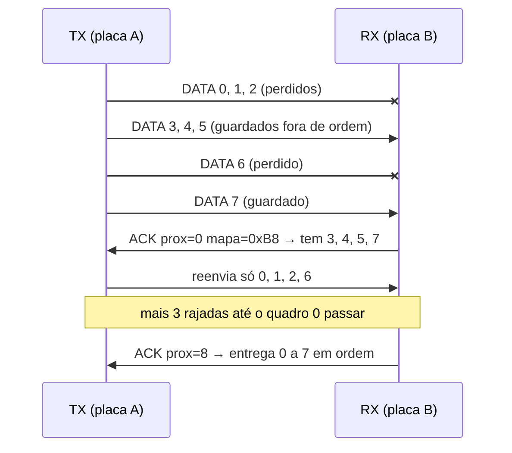

# Arquitetura e protocolo

O protocolo tem quatro partes: o **quadro** organiza os dados, o **CRC-8** detecta erros, a **camada física** leva os bits pelo rádio e o **Selective Repeat** recupera o que se perdeu. Tudo o que é comum ao TX e ao RX está em `protocolo_rf.h`, então os dois lados nunca divergem.

## 1. Quadro

Igual à Figura 2 do enunciado, com no máximo 21 bytes:

| Campo | Tamanho | Conteúdo |
|---|---|---|
| FLAG | 1 byte | `0x7E`, início do quadro |
| TYPE | 1 byte | `0x01` DATA · `0x02` ACK · `0x03` END |
| SEQ | 1 byte | Número de sequência, 0 a 255 |
| LEN | 1 byte | Bytes em DATA, 0 a 16 |
| DATA | 0 a 16 bytes | Carga útil |
| FCS | 1 byte | CRC-8 de TYPE, SEQ, LEN e DATA |

| Tipo | Uso |
|---|---|
| DATA | Até 16 bytes da mensagem. O 1º byte da mensagem indica o conteúdo: `T` texto, `I` imagem |
| ACK | SEQ = **próximo quadro esperado** em ordem; LEN = 1; DATA[0] = mapa de bits dos quadros guardados à frente |
| END | Fim da mensagem (LEN = 0). Só sai depois que todos os DATA foram confirmados |

Qualquer TYPE diferente desses três, ou LEN maior que 16, faz o quadro ser descartado.

Quadro real (log do TX):

```
FLAG TYPE SEQ LEN  DATA (16 bytes)                                   FCS
 7E   01   00  10  54 41 42 43 44 45 46 47 48 49 4A 4B 4C 4D 4E 4F   42
                   T  A  B  C  D  E  F  G  H  I  J  K  L  M  N  O
```

## 2. Cálculo do FCS (CRC-8)

| Parâmetro | Valor |
|---|---|
| Polinômio gerador | x⁸ + x² + x + 1 (`0x07`) |
| Valor inicial | `0x00` |
| Reflexão de bits | não |
| XOR final | `0x00` |
| Campos cobertos | TYPE, SEQ, LEN, DATA (FLAG e FCS ficam de fora) |
| Equivalente catalogado | CRC-8/SMBUS (verificação: `"123456789"` → `0xF4`) |

```cpp
inline uint8_t crc8(const uint8_t *p, size_t n) {
  uint8_t crc = 0x00;
  for (size_t i = 0; i < n; ++i) {
    crc ^= p[i];                                   // entra o próximo byte
    for (uint8_t b = 0; b < 8; ++b)                // 8 passos da divisão polinomial
      crc = (crc & 0x80) ? uint8_t((crc << 1) ^ 0x07) : uint8_t(crc << 1);
  }
  return crc;                                      // resto = FCS
}
```

A cada byte, o registrador recebe o byte por XOR e faz 8 deslocamentos. Quando o bit que sai é 1, aplica XOR com `0x07`: é a divisão de M(x)·x⁸ por G(x) em GF(2), feita bit a bit, e o que sobra é o resto.

**Exemplo passo a passo** — quadro DATA, SEQ 0, texto `"Oi"`; bytes protegidos `01 00 02 4F 69`:

| Byte | Depois do XOR | Depois dos 8 passos |
|---|---|---|
| `01` TYPE | `01` | `07` |
| `00` SEQ | `07` | `15` |
| `02` LEN | `17` | `65` |
| `4F` 'O' | `2A` | `D6` |
| `69` 'i' | `BF` | **`34`** |

O TX envia FCS = `0x34`. O RX recalcula: se der `0x34`, aceita; senão, descarta.

**Detecção real** (teste `/erro 30`): o byte `0x59` chegou como `0xD9` (bit 7 invertido) e o CRC acusou:

```
RX quadro DATA seq=6: FCS recebido=0x07 calculado=0x33
   quadro=[01 06 10 52 53 54 55 56 57 58 D9 5A 41 42 43 44 45 46 47 07] -> ERRO DETECTADO, descartado
```

**O que o CRC-8 garante com esse polinômio:** detecta todo erro de 1 bit, todo erro com número ímpar de bits (G(x) tem o fator x + 1) e toda rajada de até 8 bits. Um erro só passa se o padrão de erro for múltiplo de G(x), cerca de 1 em 256 para erros aleatórios.

## 3. Camada física

O enunciado proíbe bibliotecas de rádio, então a forma de levar o quadro pelo ar está no próprio código:

```
[ preâmbulo 0xF0 × 8 (× 48 no ACK) ] [ FLAG 0x7E ] [ TYPE SEQ LEN DATA FCS, cada byte → 2 bytes Manchester ]
```

1. **UART2 a 1200 bit/s no pino DATA do rádio** (GPIO25 TX, GPIO34 RX). O módulo é OOK: nível 1 liga a portadora. A 2400 bit/s o receptor deformava os pulsos.
2. **UART invertida** (`invert=true`). Sem isso, o repouso da UART (nível 1) deixaria a portadora sempre ligada, e o ACK da outra placa nunca passaria.
3. **Preâmbulo `0xF0`.** Dá tempo ao controle de ganho do receptor. Na linha vira `0000011111`: metade 0, metade 1, e uma única borda de descida por byte, onde a UART do receptor se alinha.
4. **FLAG `0x7E`** marca o início do quadro.
5. **Manchester por nibble:** bit 1 → `10`, bit 0 → `01`. Cada byte vira 2 bytes, sempre com quatro bits 1. O receptor é AC-acoplado e precisa desse equilíbrio. Só 16 dos 256 valores são Manchester válidos; um byte inválido descarta o quadro na hora ("truncado"), antes do CRC.
6. **Eco:** o receptor de cada placa ouve o próprio transmissor. Depois de transmitir, o código descarta esses bytes.

Com `/erro P`, o TX inverte um bit **depois** do CRC e **antes** do Manchester: o erro chega com Manchester válido e só o CRC pode pegá-lo. É assim que o CRC é demonstrado isoladamente.

## 4. Tempos

Calculados em `protocolo_rf.h` a partir da taxa (mudar `BAUD` ajusta tudo):

| Parâmetro | Fórmula | Valor a 1200 bit/s |
|---|---|---|
| 1 byte na linha | 10 bits / 1200 | 8,33 ms |
| DATA com 16 bytes | (8 + 1 + 2·20) bytes | 49 B · 408 ms |
| END | (8 + 1 + 2·4) bytes | 17 B · 142 ms |
| ACK | (48 + 1 + 2·5) bytes | 59 B · 492 ms |
| Silêncio antes do ACK | (8 + 4)·8,33 + 25 + 300 | 425 ms |
| Timeout de cada quadro | 425 + 492 + 200 | 1117 ms |
| Intervalo entre mensagens | timeout + 300 | 1417 ms |
| TX desiste | sem confirmação nova | 20 s |
| RX descarta mensagem incompleta | sem quadro válido | 26 s |
| Espera do TX após cada ACK (v4.2) | antes da rajada seguinte | 300 ms |
| Preâmbulo do 1º quadro da rajada (v4.2) | 24 × 8,33 ms | 200 ms |

O silêncio antes do ACK precisa ser maior que o intervalo entre dois quadros da mesma rajada; senão o RX responderia no meio dela. Os 300 ms extras e o preâmbulo de 48 bytes no ACK existem porque o receptor da placa A, a centímetros do próprio transmissor, fica "ofuscado" logo depois de transmitir e demora para voltar a ouvir um sinal fraco. A v4.2 aplica a mesma ideia no outro sentido: depois de receber um ACK, o TX espera 300 ms e manda o primeiro quadro da rajada com 24 bytes de preâmbulo, porque agora é o receptor da placa B que acabou de transmitir.

## 5. Selective Repeat

**Transmissor (A)**

1. Divide a mensagem em quadros DATA de até 16 bytes, numerados de 0.
2. Envia uma rajada de até W quadros novos (W = 4 por padrão; 1 a 8 com `/janela N`) e para para ouvir. O canal é half-duplex: os dois rádios usam 433,92 MHz.
3. Ao receber um ACK, marca como confirmados os quadros antes de SEQ e os indicados no mapa de bits.
4. Quadro enviado antes desse ACK e que não aparece nele se perdeu: é retransmitido na hora (o ACK seletivo faz papel de NAK).
5. Sem ACK, cada quadro tem seu temporizador (1117 ms). Quando estoura, só aquele quadro é retransmitido.
6. Com todos os DATA confirmados, envia END e espera ACK com SEQ = END + 1.

**Receptor (B)**

1. Janela de 8 posições a partir do próximo SEQ esperado.
2. Quadro na janela e com CRC correto: guarda. Se for o esperado, entrega em ordem ele e os seguintes já guardados.
3. Quadro já entregue: descarta e repete o ACK (o anterior se perdeu).
4. Após 425 ms de silêncio, envia **um ACK por rajada**: SEQ = próximo esperado; DATA[0] = mapa (bit i = quadro SEQ + i guardado).
5. END em ordem: entrega a mensagem (texto no LCD e no Monitor; imagem em hexadecimal para o computador).

**Exemplo real** (`evidencias/2026-11-21_1258/logs/19_janela_8_rep1_*`):



No Go-Back-N, cada rodada reenviaria os 8 quadros (32 envios); no Selective Repeat foram 9.

**Regras de janela:** com SEQ de m = 8 bits, o SR exige W ≤ 2^(m−1) = 128. O limite de 8 vem do mapa de bits de 1 byte.

**Casos de borda**

- ACK do END perdido: o RX reconhece o END repetido e confirma de novo, sem entregar duas vezes.
- ACK atrasado de mensagem anterior: 1417 ms entre mensagens, e cada mensagem recomeça em SEQ 0.
- Enlace caiu: TX desiste em 20 s, RX descarta em 26 s; os dois recomeçam juntos em SEQ 0.
- Problema dos dois generais: se o último ACK sempre se perder, o RX entrega e o TX registra "abandonada". O dado nunca chega duplicado nem corrompido.
