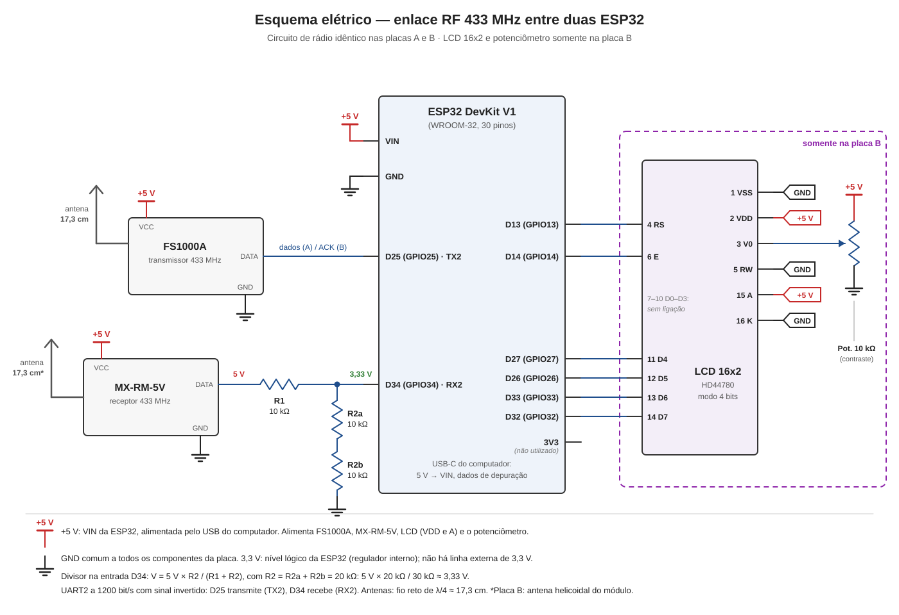
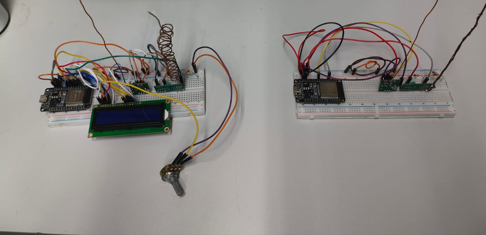
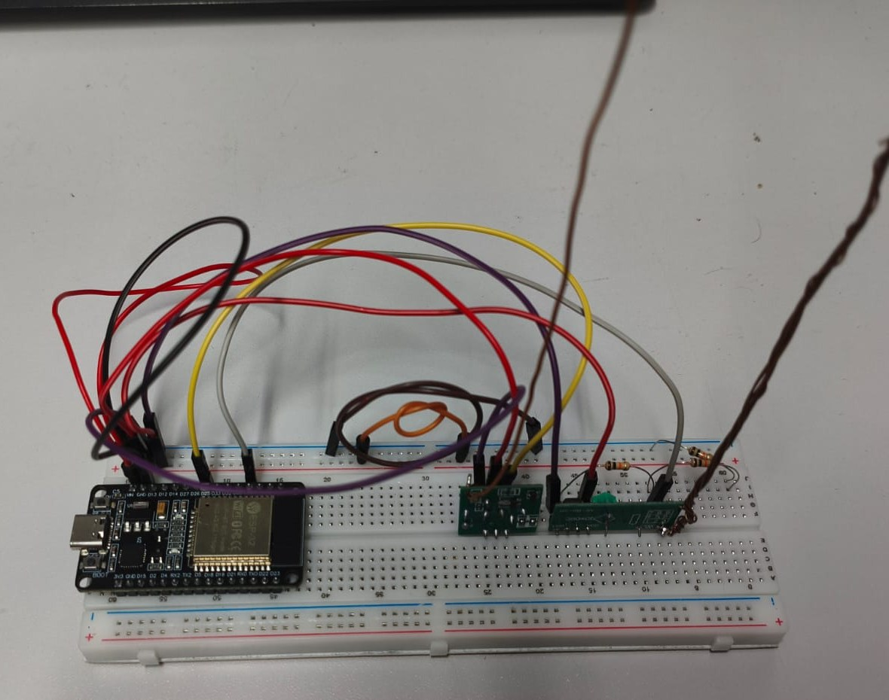
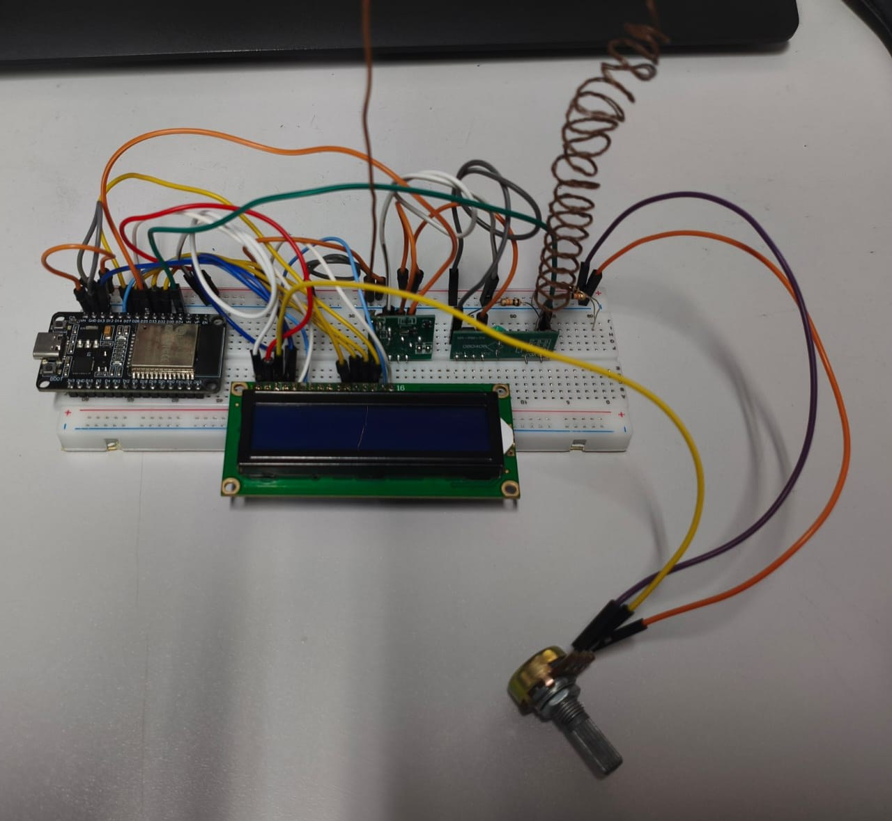
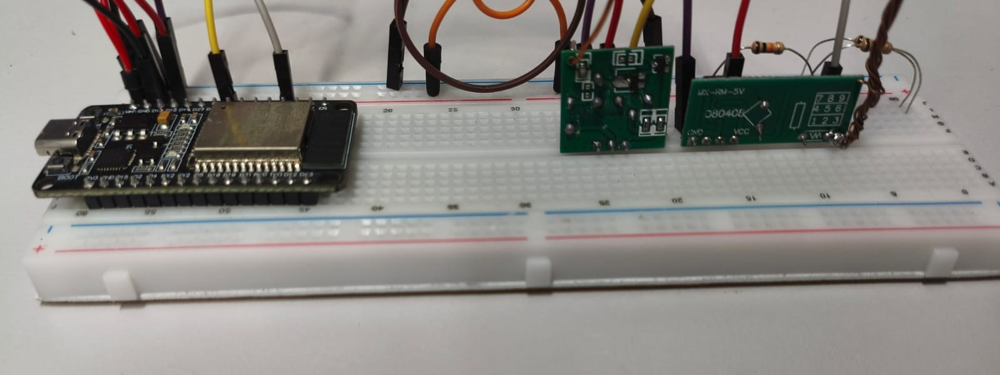

# Montagem

As duas placas têm a mesma montagem de rádio. Só a placa B (receptor) tem o LCD.

## Esquema elétrico



## Materiais

| Item | Qtd. | Observação |
|---|---|---|
| ESP32 DevKit V1 (WROOM-32, 30 pinos, USB-C) | 2 | Uma por lado |
| Transmissor RF 433 MHz FS1000A | 2 | Um por placa |
| Receptor RF 433 MHz MX-RM-5V (XY-MK-5V) | 2 | Um por placa |
| LCD 16x2 paralelo (HD44780) | 1 | Só na placa B |
| Potenciômetro 10 kΩ (B10K) | 1 | Contraste do LCD; sem ele, V0 direto no GND também funciona |
| Resistor 10 kΩ | 6 | 3 por placa (divisor de tensão) |
| Fio rígido de 17,3 cm | 3 | Antenas dos dois FS1000A e do MX-RM-5V da placa A |
| Antena helicoidal (mola) do módulo | 1 | Fornecida com o MX-RM-5V; usada no receptor da placa B |
| Protoboard de 830 furos | 2 | |
| Jumpers macho-macho | ~30 | |
| Jumpers macho-fêmea | 3 | Ligação do potenciômetro, cujos terminais não encaixam na protoboard |

## Ligações (iguais nas duas placas)

| ESP32 | Liga em | Função |
|---|---|---|
| VIN (5 V do USB) | VCC do FS1000A e do MX-RM-5V | Alimentação dos rádios |
| GND | GND dos dois módulos | Referência |
| D25 (GPIO25) | DATA do FS1000A | Saída para o rádio (TX da UART2) |
| D34 (GPIO34) | DATA do MX-RM-5V **pelo divisor** | Entrada do rádio (RX da UART2) |

A ESP32 de 30 pinos cobre um lado inteiro da protoboard, então todos os pinos usados ficam no lado que sobra livre (VIN, GND, D13 a D34).

**Atenção à serigrafia dos módulos:** a ordem VCC/DATA/GND muda entre fabricantes. No MX-RM-5V, os dois pinos do meio são DATA (qualquer um serve).

## Divisor de tensão (receptor → GPIO34)

O receptor precisa de 5 V e sua saída também chega a 5 V; o GPIO da ESP32 aceita no máximo 3,3 V.

```
DATA do receptor ── 10 kΩ ──┬── D34
                            │
                          10 kΩ
                            │
                          10 kΩ
                            │
                           GND
```

V(D34) = 5 V × 20 kΩ / (10 kΩ + 20 kΩ) = **3,33 V**

## LCD (só placa B, modo 4 bits)

| Pino do LCD | Liga em |
|---|---|
| 1 VSS, 5 RW, 16 K | GND |
| 2 VDD, 15 A | 5 V |
| 3 V0 | Pino do meio do potenciômetro (pontas no 5 V e no GND) |
| 4 RS · 6 E | D13 · D14 |
| 11 D4 · 12 D5 · 13 D6 · 14 D7 | D27 · D26 · D33 · D32 |
| 7 a 10 (D0–D3) | Sem ligação |

Se o LCD mostrar só quadrados ou nada, gire o potenciômetro (o contraste muda com a tensão do USB).

## Antena

Fio reto de um quarto de onda, soldado no furo ANT de cada módulo:

λ/4 = c / (4·f) = 3×10⁸ / (4 × 433,92×10⁶) ≈ **17,3 cm**

Nos testes, as antenas ficaram retas, na vertical e paralelas.

## Cuidados que fizeram diferença na bancada

- **Alimentação:** ligue as placas em notebook (de preferência na bateria) ou carregador de tomada com cabo USB-A → USB-C. Um desktop ao lado da placa injetou ruído suficiente para derrubar o alcance para 60–70 cm.
- **Distância do computador:** deixe as placas a pelo menos 30 cm do notebook.
- **Celular longe** do receptor durante testes normais.
- **Módulos firmes:** os pinos dos módulos são curtos; um mau contato causa falhas intermitentes.

## Fotos



| Placa A (transmissor) | Placa B (receptor com LCD) |
|---|---|
|  |  |


