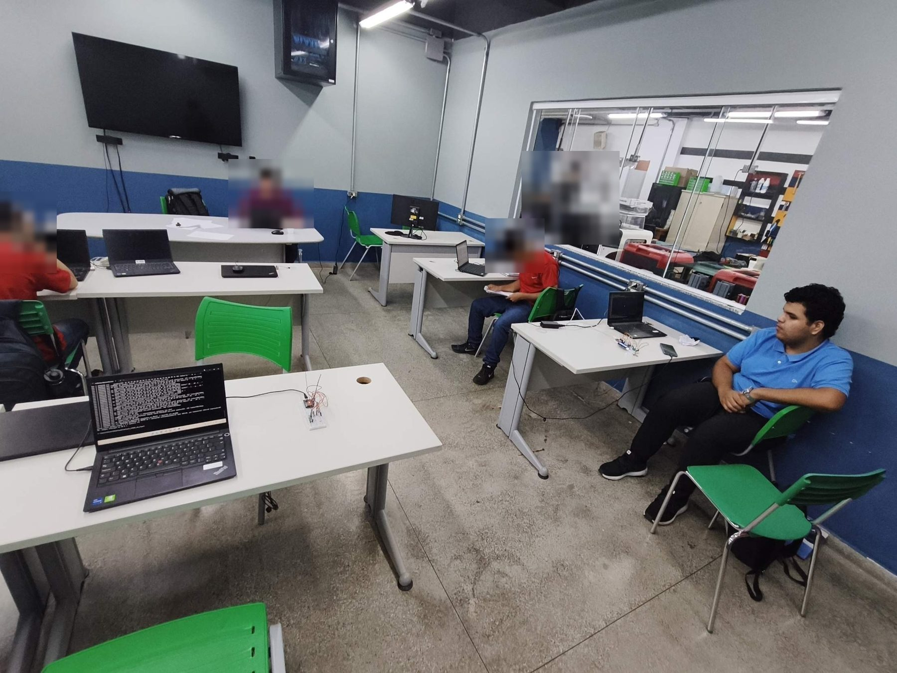
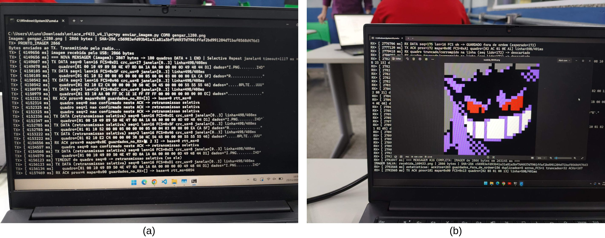
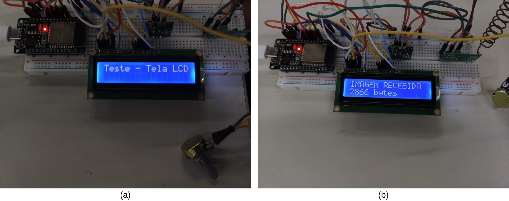

# Resultados

Bateria de testes de 21/11/2026 (12h58 às 13h47), firmware v4.1, 3 repetições por cenário, gerada por `pc/coletar_testes.py`. Arquivos brutos em [`evidencias/2026-11-21_1258/`](../evidencias/2026-11-21_1258/).

**33 de 36 mensagens entregues (91,7%), nenhuma com erro.** As 3 falhas foram abandonadas pelo TX depois de 20 s sem confirmação.

Condições: as duas placas no mesmo notebook (na bateria), sem nenhum fio de dados entre elas; antenas retas e verticais; distância medida de antena a antena; ambiente interno. Mensagem de teste: `/teste 200` = 201 bytes = 13 quadros DATA + END (ruído: 500 caracteres; imagem: PNG 32×32 de 490 bytes).

Tempo e retransmissões abaixo = média dos testes **entregues**.

## Distância

| Distância | Entregues | Tempo médio | Retransmissões | ACKs enviados pelo RX / recebidos pelo TX |
|---|---|---|---|---|
| 0,5 m | 3 de 3 | 10,3 s | 0 | 15 / 15 |
| 1,0 m | 2 de 3 | 13,9 s | 2,5 | 24 / 12 |
| 1,5 m | 2 de 3 | 29,9 s | 18 | 37 / 19 |
| 2,0 m | 3 de 3 | 19,8 s | 8 | 22 / 20 |

A 1 m e 1,5 m, metade dos ACKs se perdeu na volta (placa B → placa A); os dados chegavam, a confirmação não. O desempenho não cai de forma regular com a distância porque, dentro de casa, a posição exata (reflexões, objetos próximos) pesa tanto quanto a distância.

## Janela: Stop-and-Wait × Selective Repeat

Modelo de canal limpo: cada quadro cheio ocupa ~437 ms e cada rajada termina com ~900 ms de espera pelo ACK. Para janela 4 o modelo prevê 10,2 s; o medido a 0,5 m foi **10,26 s**.

| Janela | Teórico (canal limpo) | Média medida a 1 m | Melhor caso | Retransmissões |
|---|---|---|---|---|
| 1 (Stop-and-Wait) | 18,3 s | 41,5 s | 40,0 s | 15 |
| 4 | 10,2 s | 26,9 s | 18,8 s | 14 |
| 8 | 8,4 s | 18,1 s | 12,7 s | 9,7 |

Janela 8 foi **56% mais rápida** que Stop-and-Wait. No Stop-and-Wait, cada quadro paga ~900 ms de espera pelo ACK; com janela 8, essa espera é dividida por 8 quadros.

## Erros, perdas e ruído

| Cenário | Entregues | Tempo médio | Retransmissões | Erros detectados pelo CRC no RX |
|---|---|---|---|---|
| `/erro 30` | 3 de 3 | 28,1 s | 14 | 17 |
| `/perda 30` | 3 de 3 | 41,2 s | 38,3 | 0 |
| Ruído real (celular encostado no RX) | 2 de 3 | 46,9 s | 19 | 0 |

Na repetição 2 do ruído real, além do celular, uma mão cobriu a antena do RX; o canal ficou inutilizável e o TX abandonou a mensagem sem entregar nada errado.

## Imagem

| Cenário | Entregues | Tempo médio | Retransmissões | Erros CRC | SHA-256 igual ao original |
|---|---|---|---|---|---|
| Limpa | 3 de 3 | 44,1 s | 15,3 | 0 | 3 de 3 |
| `/erro 30` | 3 de 3 | 59,5 s | 32 | 13,3 | 3 de 3 |

SHA-256 da original e das 6 recebidas: `80e0254066353f1ba5c001529b17b0036d4843329d59aee5de46a81e93f48204`.

## Detecção de erros e custo do CRC

| Nível de descarte | Quadros | Origem |
|---|---|---|
| Manchester inválido ("truncado") | 186 | Erros reais do canal |
| CRC-8 diferente do calculado | 57 | Bits invertidos pelo `/erro` (83 no total; os demais não chegaram inteiros ao RX) |
| Aceitos com erro | **0** | — |

| Tempo do CRC-8 (ESP32, quadros de até 19 bytes) | Amostras | Mediana | Média | Máximo |
|---|---|---|---|---|
| Cálculo no TX (`crc_us`) | 1252 | 8 µs | 8,1 µs | 22 µs |
| Verificação no RX (`verif_us`) | 694 | 8 µs | 7,9 µs | 13 µs |

## Achado: o primeiro quadro de cada rajada sofre mais

Nos testes sem erro ou perda simulados, o primeiro quadro de cada rajada foi confirmado em **72%** das vezes (165 de 229), contra **93%** dos demais (482 de 516). O TX começa a rajada ~10 ms depois de receber o ACK, quando o receptor da placa B acabou de transmitir esse ACK e ainda está com o ganho baixo. Isso levou à [versão 4.2](#versão-42-e-ensaio-a-34-m-2511): espera de 300 ms após cada ACK e preâmbulo maior no primeiro quadro da rajada.

## Todos os testes

| # | Cenário | Rep. | Dist. (m) | Janela | Resultado | Integridade | Tempo (s) | Envios | Retransm. (ACK / timeout) | ACKs recebidos | Erros CRC no RX | Log |
|---|---|---|---|---|---|---|---|---|---|---|---|---|
| 1 | distancia_0.5m | 1 | 0,50 | 4 | ENTREGUE | OK | 10,3 | 14 | 0 (0 / 0) | 5 | 0 | [TX](../evidencias/2026-11-21_1258/logs/01_distancia_0.5m_rep1_TX.txt) · [RX](../evidencias/2026-11-21_1258/logs/01_distancia_0.5m_rep1_RX.txt) |
| 2 | distancia_0.5m | 2 | 0,50 | 4 | ENTREGUE | OK | 10,3 | 14 | 0 (0 / 0) | 5 | 0 | [TX](../evidencias/2026-11-21_1258/logs/02_distancia_0.5m_rep2_TX.txt) · [RX](../evidencias/2026-11-21_1258/logs/02_distancia_0.5m_rep2_RX.txt) |
| 3 | distancia_0.5m | 3 | 0,50 | 4 | ENTREGUE | OK | 10,3 | 14 | 0 (0 / 0) | 5 | 0 | [TX](../evidencias/2026-11-21_1258/logs/03_distancia_0.5m_rep3_TX.txt) · [RX](../evidencias/2026-11-21_1258/logs/03_distancia_0.5m_rep3_RX.txt) |
| 4 | distancia_1.0m | 1 | 1,00 | 4 | FALHA | NAO_RECEBIDO | 25,3 | 36 | 24 (0 / 24) | 2 | 0 | [TX](../evidencias/2026-11-21_1258/logs/04_distancia_1.0m_rep1_TX.txt) · [RX](../evidencias/2026-11-21_1258/logs/04_distancia_1.0m_rep1_RX.txt) |
| 5 | distancia_1.0m | 2 | 1,00 | 4 | ENTREGUE | OK | 17,5 | 19 | 5 (0 / 5) | 5 | 0 | [TX](../evidencias/2026-11-21_1258/logs/05_distancia_1.0m_rep2_TX.txt) · [RX](../evidencias/2026-11-21_1258/logs/05_distancia_1.0m_rep2_RX.txt) |
| 6 | distancia_1.0m | 3 | 1,00 | 4 | ENTREGUE | OK | 10,3 | 14 | 0 (0 / 0) | 5 | 0 | [TX](../evidencias/2026-11-21_1258/logs/06_distancia_1.0m_rep3_TX.txt) · [RX](../evidencias/2026-11-21_1258/logs/06_distancia_1.0m_rep3_RX.txt) |
| 7 | distancia_1.5m | 1 | 1,50 | 4 | FALHA | NAO_RECEBIDO | 57,5 | 58 | 45 (2 / 43) | 5 | 0 | [TX](../evidencias/2026-11-21_1258/logs/07_distancia_1.5m_rep1_TX.txt) · [RX](../evidencias/2026-11-21_1258/logs/07_distancia_1.5m_rep1_RX.txt) |
| 8 | distancia_1.5m | 2 | 1,50 | 4 | ENTREGUE | OK | 24,6 | 28 | 14 (2 / 12) | 7 | 0 | [TX](../evidencias/2026-11-21_1258/logs/08_distancia_1.5m_rep2_TX.txt) · [RX](../evidencias/2026-11-21_1258/logs/08_distancia_1.5m_rep2_RX.txt) |
| 9 | distancia_1.5m | 3 | 1,50 | 4 | ENTREGUE | OK | 35,0 | 36 | 22 (4 / 18) | 7 | 0 | [TX](../evidencias/2026-11-21_1258/logs/09_distancia_1.5m_rep3_TX.txt) · [RX](../evidencias/2026-11-21_1258/logs/09_distancia_1.5m_rep3_RX.txt) |
| 10 | distancia_2.0m | 1 | 2,00 | 4 | ENTREGUE | OK | 21,7 | 26 | 12 (1 / 11) | 6 | 0 | [TX](../evidencias/2026-11-21_1258/logs/10_distancia_2.0m_rep1_TX.txt) · [RX](../evidencias/2026-11-21_1258/logs/10_distancia_2.0m_rep1_RX.txt) |
| 11 | distancia_2.0m | 2 | 2,00 | 4 | ENTREGUE | OK | 18,8 | 20 | 6 (2 / 4) | 7 | 0 | [TX](../evidencias/2026-11-21_1258/logs/11_distancia_2.0m_rep2_TX.txt) · [RX](../evidencias/2026-11-21_1258/logs/11_distancia_2.0m_rep2_RX.txt) |
| 12 | distancia_2.0m | 3 | 2,00 | 4 | ENTREGUE | OK | 18,8 | 20 | 6 (2 / 4) | 7 | 0 | [TX](../evidencias/2026-11-21_1258/logs/12_distancia_2.0m_rep3_TX.txt) · [RX](../evidencias/2026-11-21_1258/logs/12_distancia_2.0m_rep3_RX.txt) |
| 13 | janela_1_SAW | 1 | 1,00 | 1 | ENTREGUE | OK | 40,0 | 28 | 14 (0 / 14) | 14 | 0 | [TX](../evidencias/2026-11-21_1258/logs/13_janela_1_SAW_rep1_TX.txt) · [RX](../evidencias/2026-11-21_1258/logs/13_janela_1_SAW_rep1_RX.txt) |
| 14 | janela_1_SAW | 2 | 1,00 | 1 | ENTREGUE | OK | 43,1 | 30 | 16 (0 / 16) | 14 | 0 | [TX](../evidencias/2026-11-21_1258/logs/14_janela_1_SAW_rep2_TX.txt) · [RX](../evidencias/2026-11-21_1258/logs/14_janela_1_SAW_rep2_RX.txt) |
| 15 | janela_1_SAW | 3 | 1,00 | 1 | ENTREGUE | OK | 41,5 | 29 | 15 (0 / 15) | 14 | 0 | [TX](../evidencias/2026-11-21_1258/logs/15_janela_1_SAW_rep3_TX.txt) · [RX](../evidencias/2026-11-21_1258/logs/15_janela_1_SAW_rep3_RX.txt) |
| 16 | janela_4 | 1 | 1,00 | 4 | ENTREGUE | OK | 43,1 | 42 | 28 (7 / 21) | 9 | 0 | [TX](../evidencias/2026-11-21_1258/logs/16_janela_4_rep1_TX.txt) · [RX](../evidencias/2026-11-21_1258/logs/16_janela_4_rep1_RX.txt) |
| 17 | janela_4 | 2 | 1,00 | 4 | ENTREGUE | OK | 18,8 | 22 | 8 (1 / 7) | 6 | 0 | [TX](../evidencias/2026-11-21_1258/logs/17_janela_4_rep2_TX.txt) · [RX](../evidencias/2026-11-21_1258/logs/17_janela_4_rep2_RX.txt) |
| 18 | janela_4 | 3 | 1,00 | 4 | ENTREGUE | OK | 18,8 | 20 | 6 (2 / 4) | 7 | 0 | [TX](../evidencias/2026-11-21_1258/logs/18_janela_4_rep3_TX.txt) · [RX](../evidencias/2026-11-21_1258/logs/18_janela_4_rep3_RX.txt) |
| 19 | janela_8 | 1 | 1,00 | 8 | ENTREGUE | OK | 20,4 | 26 | 12 (8 / 4) | 7 | 0 | [TX](../evidencias/2026-11-21_1258/logs/19_janela_8_rep1_TX.txt) · [RX](../evidencias/2026-11-21_1258/logs/19_janela_8_rep1_RX.txt) |
| 20 | janela_8 | 2 | 1,00 | 8 | ENTREGUE | OK | 21,3 | 28 | 14 (10 / 4) | 7 | 0 | [TX](../evidencias/2026-11-21_1258/logs/20_janela_8_rep2_TX.txt) · [RX](../evidencias/2026-11-21_1258/logs/20_janela_8_rep2_RX.txt) |
| 21 | janela_8 | 3 | 1,00 | 8 | ENTREGUE | OK | 12,7 | 17 | 3 (1 / 2) | 4 | 0 | [TX](../evidencias/2026-11-21_1258/logs/21_janela_8_rep3_TX.txt) · [RX](../evidencias/2026-11-21_1258/logs/21_janela_8_rep3_RX.txt) |
| 22 | erro_sim_30 | 1 | 1,00 | 4 | ENTREGUE | OK | 29,7 | 31 | 17 (9 / 8) | 10 | 8 | [TX](../evidencias/2026-11-21_1258/logs/22_erro_sim_30_rep1_TX.txt) · [RX](../evidencias/2026-11-21_1258/logs/22_erro_sim_30_rep1_RX.txt) |
| 23 | erro_sim_30 | 2 | 1,00 | 4 | ENTREGUE | OK | 33,9 | 31 | 17 (5 / 12) | 9 | 8 | [TX](../evidencias/2026-11-21_1258/logs/23_erro_sim_30_rep2_TX.txt) · [RX](../evidencias/2026-11-21_1258/logs/23_erro_sim_30_rep2_RX.txt) |
| 24 | erro_sim_30 | 3 | 1,00 | 4 | ENTREGUE | OK | 20,7 | 22 | 8 (4 / 4) | 8 | 1 | [TX](../evidencias/2026-11-21_1258/logs/24_erro_sim_30_rep3_TX.txt) · [RX](../evidencias/2026-11-21_1258/logs/24_erro_sim_30_rep3_RX.txt) |
| 25 | perda_sim_30 | 1 | 1,00 | 4 | ENTREGUE | OK | 27,0 | 27 | 13 (3 / 10) | 8 | 0 | [TX](../evidencias/2026-11-21_1258/logs/25_perda_sim_30_rep1_TX.txt) · [RX](../evidencias/2026-11-21_1258/logs/25_perda_sim_30_rep1_RX.txt) |
| 26 | perda_sim_30 | 2 | 1,00 | 4 | ENTREGUE | OK | 22,8 | 32 | 18 (4 / 14) | 8 | 0 | [TX](../evidencias/2026-11-21_1258/logs/26_perda_sim_30_rep2_TX.txt) · [RX](../evidencias/2026-11-21_1258/logs/26_perda_sim_30_rep2_RX.txt) |
| 27 | perda_sim_30 | 3 | 1,00 | 4 | ENTREGUE | OK | 73,9 | 98 | 84 (9 / 75) | 12 | 0 | [TX](../evidencias/2026-11-21_1258/logs/27_perda_sim_30_rep3_TX.txt) · [RX](../evidencias/2026-11-21_1258/logs/27_perda_sim_30_rep3_RX.txt) |
| 28 | ruido_real | 1 | 1,00 | 4 | ENTREGUE | OK | 49,9 | 56 | 23 (13 / 10) | 19 | 0 | [TX](../evidencias/2026-11-21_1258/logs/28_ruido_real_rep1_TX.txt) · [RX](../evidencias/2026-11-21_1258/logs/28_ruido_real_rep1_RX.txt) |
| 29 | ruido_real | 2 | 1,00 | 4 | FALHA | NAO_RECEBIDO | 22,4 | 32 | 26 (1 / 25) | 1 | — | [TX](../evidencias/2026-11-21_1258/logs/29_ruido_real_rep2_TX.txt) · [RX](../evidencias/2026-11-21_1258/logs/29_ruido_real_rep2_RX.txt) |
| 30 | ruido_real | 3 | 1,00 | 4 | ENTREGUE | OK | 43,9 | 48 | 15 (7 / 8) | 16 | 0 | [TX](../evidencias/2026-11-21_1258/logs/30_ruido_real_rep3_TX.txt) · [RX](../evidencias/2026-11-21_1258/logs/30_ruido_real_rep3_RX.txt) |
| 31 | imagem_limpa | 1 | 1,00 | 4 | ENTREGUE | OK | 45,1 | 48 | 16 (7 / 9) | 16 | — | [TX](../evidencias/2026-11-21_1258/logs/31_imagem_limpa_rep1_TX.txt) · [RX](../evidencias/2026-11-21_1258/logs/31_imagem_limpa_rep1_RX.txt) |
| 32 | imagem_limpa | 2 | 1,00 | 4 | ENTREGUE | OK | 43,5 | 47 | 15 (7 / 8) | 16 | 0 | [TX](../evidencias/2026-11-21_1258/logs/32_imagem_limpa_rep2_TX.txt) · [RX](../evidencias/2026-11-21_1258/logs/32_imagem_limpa_rep2_RX.txt) |
| 33 | imagem_limpa | 3 | 1,00 | 4 | ENTREGUE | OK | 43,5 | 47 | 15 (7 / 8) | 16 | 0 | [TX](../evidencias/2026-11-21_1258/logs/33_imagem_limpa_rep3_TX.txt) · [RX](../evidencias/2026-11-21_1258/logs/33_imagem_limpa_rep3_RX.txt) |
| 34 | imagem_erro_30 | 1 | 1,00 | 4 | ENTREGUE | OK | 58,9 | 60 | 28 (13 / 15) | 19 | 10 | [TX](../evidencias/2026-11-21_1258/logs/34_imagem_erro_30_rep1_TX.txt) · [RX](../evidencias/2026-11-21_1258/logs/34_imagem_erro_30_rep1_RX.txt) |
| 35 | imagem_erro_30 | 2 | 1,00 | 4 | ENTREGUE | OK | 57,8 | 62 | 30 (10 / 20) | 17 | 14 | [TX](../evidencias/2026-11-21_1258/logs/35_imagem_erro_30_rep2_TX.txt) · [RX](../evidencias/2026-11-21_1258/logs/35_imagem_erro_30_rep2_RX.txt) |
| 36 | imagem_erro_30 | 3 | 1,00 | 4 | ENTREGUE | OK | 61,8 | 70 | 38 (19 / 19) | 22 | 16 | [TX](../evidencias/2026-11-21_1258/logs/36_imagem_erro_30_rep3_TX.txt) · [RX](../evidencias/2026-11-21_1258/logs/36_imagem_erro_30_rep3_RX.txt) |

## Ensaios com dois computadores (23/11)

Uma placa em cada notebook, como pede o enunciado. Evidências completas em [`evidencias/2026-11-23_dois_computadores/`](../evidencias/2026-11-23_dois_computadores/).

| Disposição: placa A e notebook A na frente, placa B e notebook B ao fundo |
|---|
|  |

#### Bateria de distância e janela (21 testes)

`coletar_testes.py --modo tx` no notebook A, `--modo rx` no notebook B e `--modo juntar` no fim (diferença entre os relógios estimada em 0,66 s). Mensagem `/teste 200` (201 bytes), 3 repetições. Arquivos: [`bateria/resultados.csv`](../evidencias/2026-11-23_dois_computadores/bateria/resultados.csv) · [`resumo.txt`](../evidencias/2026-11-23_dois_computadores/bateria/resumo.txt) · [`logs/`](../evidencias/2026-11-23_dois_computadores/bateria/logs/) (42 arquivos, TX e RX de cada teste).

| Cenário | Entregues | Tempo médio | Retransmissões | ACKs perdidos no retorno |
|---|---|---|---|---|
| 0,5 m, janela 4 | 3 de 3 | 10,3 s | 0 | 0 |
| 1,0 m, janela 4 | 3 de 3 | 19,5 s | 6,7 | 0 |
| 1,5 m, janela 4 | 3 de 3 | 18,8 s | 6,0 | 0 |
| 2,0 m, janela 4 | **1 de 3** | 33,7 s | 17 | 0 na entrega; nas 2 falhas o RX não recebeu nada |
| 1 m, janela 1 (Stop-and-Wait) | 3 de 3 | 38,9 s | 13,3 | 1 |
| 1 m, janela 4 | 3 de 3 | 19,8 s | 7,3 | 1 |
| 1 m, janela 8 | 3 de 3 | 12,7 s | 3,0 | 0 |

- **19 de 21 entregues, todas idênticas.** Estável até 1,5 m; o limite dessa disposição fica entre 1,5 m e 2 m.
- **O ACK de volta deixou de ser o problema:** em 21/11 cerca de metade dos ACKs se perdia a 1–1,5 m; aqui só 2 se perderam na bateria inteira.
- **Janela 8 foi 67% mais rápida que Stop-and-Wait.** No Stop-and-Wait todo quadro é o primeiro da sua rajada, e ~13 dos 14 precisaram de retransmissão por *timeout*: o tempo praticamente dobrou em relação aos 18,3 s previstos para canal limpo. É o mesmo efeito do [achado 5.1.5](../README.md#515-achado-o-primeiro-quadro-de-cada-rajada-sofre-mais).

#### Imagens a 1,8 m

| Medida | PNG 32×32 | PNG 1280×1280 |
|---|---|---|
| Tamanho | 490 bytes (31 quadros + END) | 2866 bytes (180 quadros + END) |
| Tempo no receptor | 64,5 s | 263,1 s |
| Vazão útil | 7,6 bytes/s | 10,9 bytes/s (87 bit/s, ~7% dos 1200 bit/s da linha) |
| Quadros rejeitados pelo CRC | 0 | 1 (erro real do canal, sem `/erro`) |
| SHA-256 enviado = recebido | ✅ `80e02540…f48204` | ✅ `c56983ef…68d476d3` |

| SHA-256 no transmissor (a) e imagem reconstruída no receptor com o mesmo SHA-256 (b) |
|---|
|  |

| LCD da placa B: texto recebido (a) e aviso da imagem de 2866 bytes (b) |
|---|
|  |

Na mesma sessão (~78 min, incluindo tentativas de alcance acima de 1,7 m), o `/resumo` do TX registrou 63 mensagens, 50 entregues e 13 abandonadas, com 566 retransmissões: **495 por *timeout*** e 71 por lacuna no mapa de bits. Na distância limite, o que se perde é o ACK de volta. Nessa montagem o enlace foi estável até ~1,5 m e intermitente a partir de ~1,7 m.

## Diagnóstico do receptor e ajuste de sintonia (24/11 e 25/11)

Em 24/11 o enlace só funcionava com as placas a menos de 50 cm; acima disso, o TX abandonava as mensagens após 20 s sem confirmação.

| Teste | Resultado | Conclusão |
|---|---|---|
| VIN–GND com multímetro, nos dois notebooks | 4,75–5,05 V | Alimentação descartada |
| Trocar os FS1000A entre as placas | Nada mudou | Transmissores descartados |
| Trocar os MX-RM-5V entre as placas | A falha mudou de lado junto com o receptor que tinha a antena de mola (na placa A, ACKs perdidos; na placa B, dados truncados) | Defeito nesse receptor |
| Mexer na base da mola | Comportamento mudava | Mau contato ou dessintonia |
| Trocar a mola por fio reto de 17,3 cm | Sem melhora de alcance | Não era só a antena |
| Módulo emprestado na mesma posição | Funcionou mesmo sem antena | Confirma o receptor |
| Tensão média no DATA com o TX da própria placa ligado | 1,6–2,9 V | Receptor vivo, mas pouco sensível |

**Ajuste:** o MX-RM-5V tem um componente de sintonia ajustável. Com a posição original marcada, ele foi girado em passos de ~1/8 de volta com chave não metálica, placas a 1 m e o TX enviando `/teste 200`, olhando no log do RX a proporção de quadros aceitos × truncados. O alcance voltou a 2 m e depois chegou a **~3,4 m**. Na configuração final esse receptor está na **placa B**, onde também estava nas baterias de 21 e 23/11.

## Versão 4.2 e ensaio a 3,4 m (25/11)

A v4.2 muda só o TX, e só temporização: espera de **300 ms após cada ACK** e **preâmbulo de 24 bytes** (em vez de 8) no primeiro quadro de cada rajada, os dois contra a [perda do primeiro quadro](#achado-o-primeiro-quadro-de-cada-rajada-sofre-mais). O quadro não mudou; o RX segue na v4.1. O simulador passa em todos os cenários com a v4.2.

| Rep. | Resultado | Tempo | Retransmissões | ACKs recebidos |
|---|---|---|---|---|
| 1 | ✅ entregue, íntegra | 12,1 s | 0 | 5 |
| 2 | ✅ entregue, íntegra | 12,1 s | 0 | 5 |
| 3 | ❌ abandonada | 20,2 s | 24 (timeout) | 0 |

- Nas entregas, **nenhuma retransmissão** (v4.1, a 1–1,5 m em 23/11: 6 a 7 por mensagem, quase todas do primeiro quadro da rajada).
- Tempo previsto: 10,2 s do modelo para janela 4 + 4 × 300 ms + 5 × 133 ms de preâmbulo extra ≈ **12,1 s**; medido **12,10 s**.
- Na repetição 3, o RX recebeu tudo e mandou 7 ACKs; nenhum chegou à placa A, cujo receptor não foi reajustado.
- Com só três repetições, e com o receptor recém-ajustado, não dá para separar o ganho da v4.2 do ganho da sintonia.

Arquivos: [`evidencias/2026-11-25_alcance_3.4m/`](../evidencias/2026-11-25_alcance_3.4m/).
